# LangChain

# 1、简介

## 大模型的局限性：

- 知识受限于训练数据
- 无法直接于外部系统交互
- 不具备状态保持能力（缺少上下文记忆）


## LangChain 的定位

1. 大通大模型与外部资源：可以对接数据库、检索引擎、API、文件系统等 
2. 封装底层复杂逻辑：抽象工具调用、记忆等能力
3. 支持多智能体协作

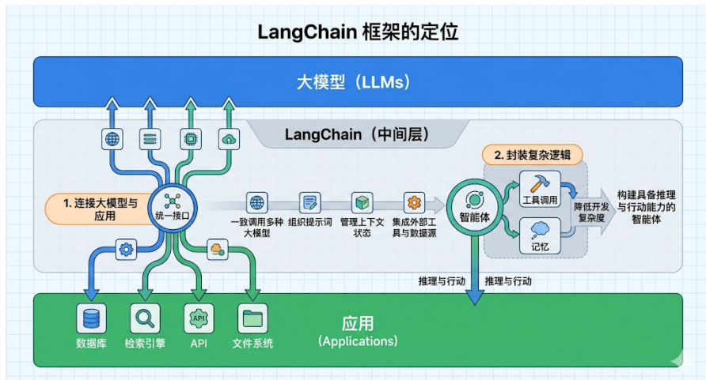


## LangChain缺点：

1. 文档混乱&更新滞后
2. 抽象过度&调试困难
3. 版本不兼容

## **重要版本**：

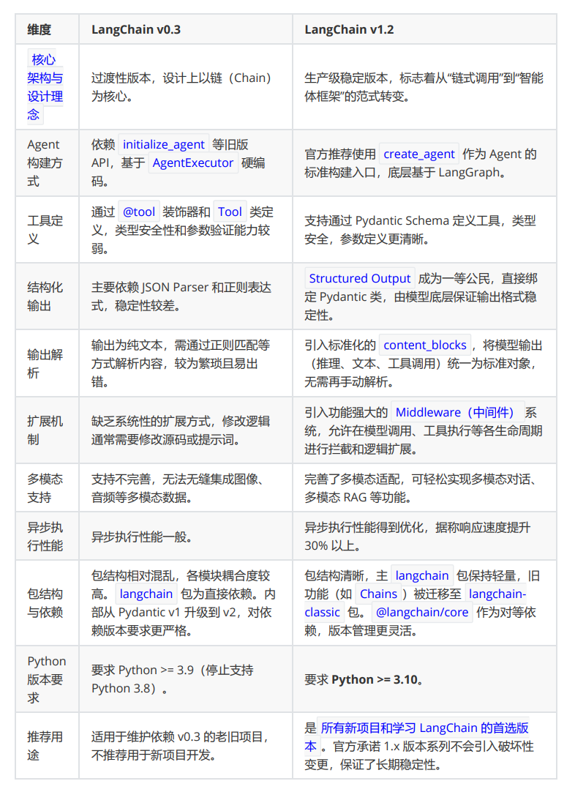

> 本文按当前实测环境核对：`langchain==1.2.12`、`langchain-core==1.4.9`、`langgraph==1.1.10`、`langgraph-prebuilt==1.0.13`、`langsmith==0.10.9`、`langchain-openai==1.1.11`。

## 核心模块

- **langchain-core** ：官方推荐的核心API。比如 Runnable, BaseMessage等
- **langchain-classic** ：冗余代码移或不推荐使用的经典API移到此。比如0.x中常用而1.x移除的API都 在这里。 
- **langchain-community** ：主要提供社区集成；`langchain-openai`、`langchain-anthropic`等合作伙伴包需按需安装。
- **langgraph** ：深度整合 LangGraph，协调多个Chain、Agent、Tools完成更复杂的有状态、分支和循环任务。


## LangChain四大支柱

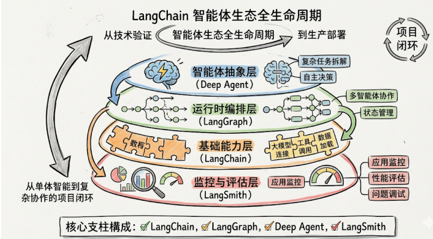

### LangChain

- 是整个生态的核心起点、为开发者提供了模型调用、工具与中间件集成、智能体构建等整套基础能力开发

如果是构建简单的智能体应用，无需复杂的编排需求，那么选择LangChain

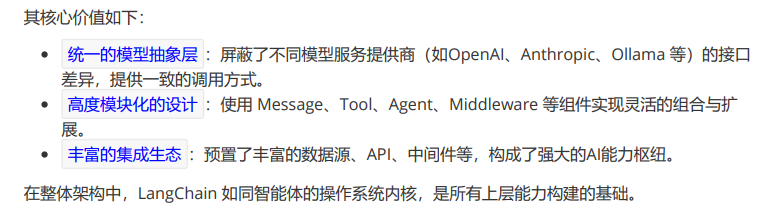

### LangGraph

智能体需要由单一指令拓展为多步骤、有状态的复杂工作流时，出现了LangGraph

- 节点：代表独立的功能单元或决策点
- 边：定义了节点之间的流转条件与路径
- 状态：作为一个共享上下文，在节点间传递并持久化存储任务信息

通过图式结构，LangGraph让智能体的工作流节点交互变更显式、可控、可观测

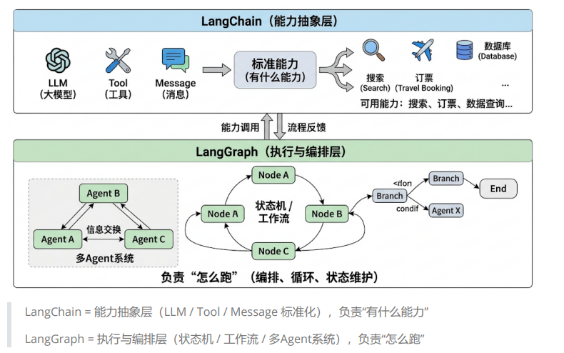


### Deep Agent 

智能体的执行框架，**构建于LangChain、LangGraph之上**、增加了规划能力、文件系统、子Agent等功能，目的是：让开发者无需从零构建复杂的控制逻辑，即可创建具备深度规划、长期记忆与多专家协作能力的智能体。

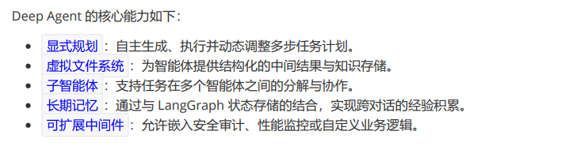

**三者关系**

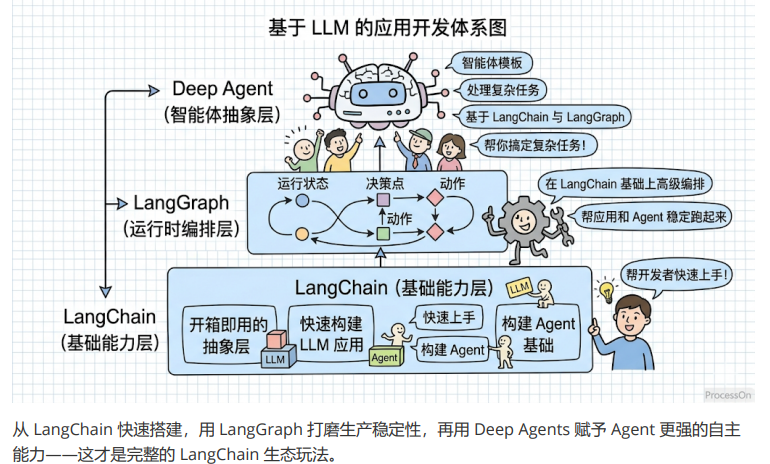

### LangSmith 

可视化监控与测试平台，用于跟踪、记录和分析智能体在运行过程中的完整调用链路，让智能体内部可视化

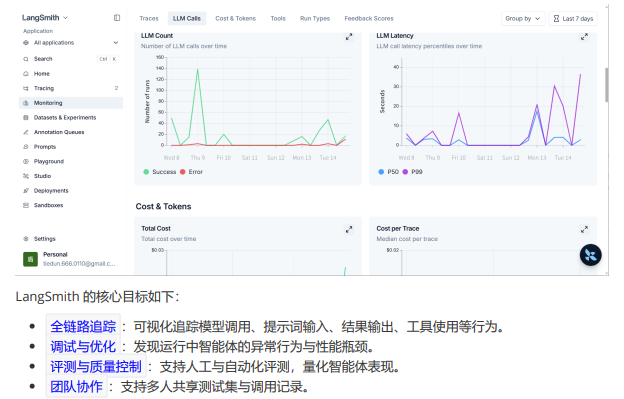

## 应用场景

### RAG

#### 1）背景：

**大模型的知识冻结**：模型无法实时学习到最新的信息或者动态变化，导致LLM难以应对最新最热点新闻等时间敏感信息

**大模型幻觉**：涉及到大模型从未在训练过程中学习过的信息时，大模型无法给出准确的答复，转而开始臆想和编造答案

#### **2）何为RAG**

**Retrieval-Augmented Generation（检索增强生成）**

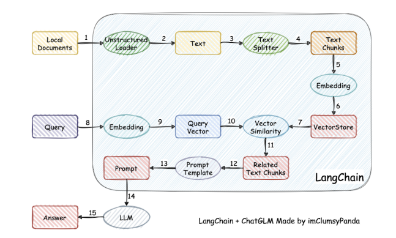

检索-增强-生成过程：检索可以理解为第10步，增强理解为第13步（这里的提示词包含检索到的数 据），生成理解为第15步。


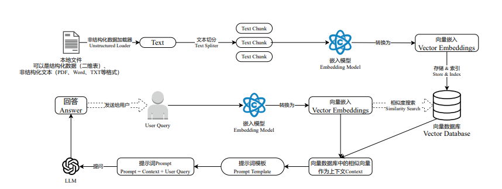


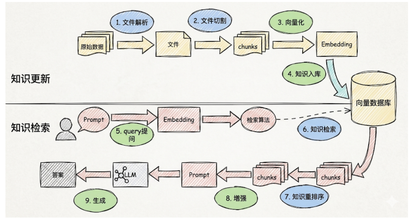

**过程中的难点**：1、文件解析 2、文件切割 3、知识检索、4、知识重排序

1、文件解析：如果是pdf，内部包含文件、图片、表格，图片上还有文字，需要处理。 

2、文件切割：没有固定的格式 

3、在 RAG 应用中，reranker（重排器）可对初步召回的较多chunk（如top 20或top 50）进行精排，提高候选排序质量，但不能找回召回阶段遗漏的文档，而且会增加延迟和成本。

此外，与基于基本矢量搜索的 RAG 相比，reranker增强型 RAG 的成本更高，但与仅依靠LLM 生 成答案相比，它的成本低些

**Reranker的使用场景**

- 适合：**追求回答高精准**和**高相关性**的场景，例如专业知识库或者智能客服
- 不适合：增加Reranker 会增加召回时间，增加检索延迟，服务对相应时间要求高时，使用rendanker则不合适


### Agent

通过LLM的推理决策能力，通过增加规划、记忆和工具调用的能力，构造一个能够独立思考、逐步完整给定目标的Agent（智能体）

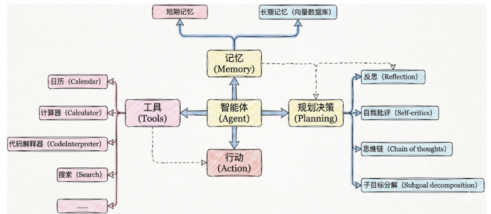

**包含模块**

1. 大模型 LLM：提供推理、规划和知识理解的能力
2. 规划决策：对复杂任务做拆解、反思和自省框架，实现对复杂任务进行处理；例如思维链将目标拆解为子任务，并通过反馈优化策略
3. 工具：调用外部工具拓展能力边界
4. 记忆：
   1. **短期记忆**：存储单次对话周期的上下文信息，属于临时信息存储机制。受限于模型的上下文窗口长 度。
   2. **长期记忆**：可以 横跨多个会话或时间周期 ，可存储并调用核心知识，非即时任务。 比如，关于用户的偏好，过去执行过的指令等。 **长期记忆，可以通过 模型参数微调（固化知识） 、 知识图谱（结构化语义网络） 或 向量数 据库（相似性检索） 方式实现。**
5. 行动：实际执行决策的模块，涵盖软件接口操作（如自动订票）和物理交互（如机器人 执行搬运）。比如：检索、推理、编程等。


# 2、模型调用

模型的调用分为： invoke() 、 stream() 和 batch() 方法，以及它们的异步版本 ainvoke() 、 astream() 和 abatch()

- invoke() ：阻塞式，一次性返回完整结果问答、批处理任务、无需实时反馈的场景。 
- ainvoke() ：非阻塞式，提高系统吞吐量高并发Web应用、IO密集型任务。 
- stream() ：流式输出，实时返回Chunk，适合聊天机器人、长文本生成等交互应用。
- astream() ：异步流式输出，适合高并发Web应用、IO密集型任务。
- batch() ：批量处理多个输入高并发场景，需要同时处理大量请求。 
- abatch() ：非阻塞式，提高系统吞吐量高并发Web应用、IO密集型任务。


### invoke()

invoke接收你的输入（问题指令等），发送给LLM模型，返回模型的相应。

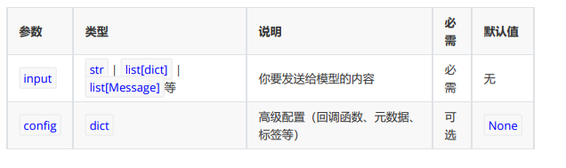

#### 输入

##### str 文本输入

**特点**：简单高效，支持简单的文本问题，没办法设置系统提示词，无法传递对话历史

```python
prompt = "翻译成英文：你好世界"
response = model.invoke(prompt)

```

##### 字典列表 文本输入

创建字典列表组成消息，一条消息包含：`角色`、`内容`等信息

**特点**:可以设置系统提示，表达多轮对话历史，JSON兼容，容易序列化和网络传输，生产环境推荐

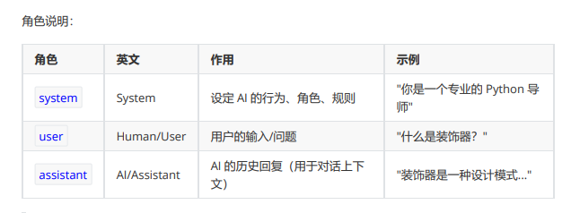

```python
messages = [
{"role": "system", "content": "系统提示"},
{"role": "user", "content": "用户消息"},
{"role": "assistant", "content": "AI回复"}, # 可选，用于对话历史
{"role": "user", "content": "继续提问"}
]
response = model.invoke(messages)
```

##### 消息对象列表

使用内置的消息类，将消息对象传递给模型

**特点**：需要类型检查，但代码太长，不如字典简洁，难以序列化

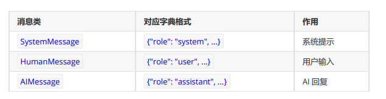

```python
messages = [
	SystemMessage(content="你是一个 Python 专家"),
	HumanMessage(content="什么是生成器？"),
]
response = model.invoke(messages)
# print(response)
# 继续对话
messages.append(AIMessage(content=response.content))
messages.append(HumanMessage(content="能给个例子吗？"))
response1 = model.invoke(messages)
print(response1)
```

#### 返回值

`invoke()` 返回一个 `AIMessage` 对象，示例结构如下：

```python
AIMessage(
    # --- 核心内容 ---
    content='2 + 3 * 2 = **8**',  # 模型生成的最终文本答案

    # --- 附加参数 ---
    additional_kwargs={
        'refusal': None,  # 模型拒绝回答时的原因；None 表示正常回答
    },

    # --- 响应元数据（API 返回的详细原始数据） ---
    response_metadata={
        'token_usage': {
            'completion_tokens': 15,  # 生成回答消耗的 Token 数（输出）
            'prompt_tokens': 16,      # 用户输入消耗的 Token 数（输入）
            'total_tokens': 31,       # 本次交互总共消耗的 Token
            'completion_tokens_details': {
                'accepted_prediction_tokens': 0,  # 预测性生成的 Token 数
                'audio_tokens': 0,                 # 音频生成消耗（如有）
                'reasoning_tokens': 0,             # 推理过程消耗的 Token
                'rejected_prediction_tokens': 0,   # 被拒绝的预测 Token 数
            },
            'prompt_tokens_details': {
                'audio_tokens': 0,    # 输入中的音频 Token 数
                'cached_tokens': 0,   # 命中的缓存 Token 数（能省钱/提速）
            },

            # --- 延迟性能监控（单位：毫秒 ms） ---
            'latency_checkpoint': {
                'engine_tbt_ms': 4,       # 引擎 Token 间平均间隔时间
                'engine_ttft_ms': 36,     # 引擎生成首个 Token 的时间
                'engine_ttlt_ms': 100,    # 引擎生成最后一个 Token 的时间
                'pre_inference_ms': 86,   # 推理前的预处理耗时
                'service_tbt_ms': 4,      # 服务端 Token 间的生成间隔
                'service_ttft_ms': 280,   # 接收请求到输出首字的总时间
                'service_ttlt_ms': 338,   # 完成全部输出的总时间
                'total_duration_ms': 259, # 本次请求在系统中记录的总持续时长
                'user_visible_ttft_ms': 194,  # 用户看到第一个字的等待时间
            },
        },
        'model_provider': 'openai',  # 模型供应商
        'model_name': 'gpt-5.4-mini-2026-03-17',  # 使用的具体模型版本
        'system_fingerprint': None,  # 用于追踪模型后端配置变更
        'id': 'chatcmpl-DgWobsxhDOqzjqVFwbZYKRnovpEiV',  # API 响应 ID
        'service_tier': 'default',  # 服务层级
        'finish_reason': 'stop',     # 停止原因：stop 或 length
        'logprobs': None,            # 词元对数概率
    },

    # --- LangChain 内部标识 ---
    id='lc_run--019e3659-5ee2-7b62-bc8a-741e27374b43-0',

    # --- 工具调用信息 ---
    tool_calls=[],           # 正常触发的外部工具调用列表
    invalid_tool_calls=[],   # 无法正确解析的工具调用

    # --- 统一消耗元数据（LangChain 标准化后的格式） ---
    usage_metadata={
        'input_tokens': 16,
        'output_tokens': 15,
        'total_tokens': 31,
        'input_token_details': {
            'audio': 0,
            'cache_read': 0,  # 从缓存中读取的输入数量
        },
        'output_token_details': {
            'audio': 0,
            'reasoning': 0,  # 输出中包含的推理 Token 数
        },
    },
)
```


##### 1. 核心内容与基本信息

- `content`：模型生成的文本回答，这是最关心的核心输出。
- `id`：本条消息的唯一标识（Message ID）。
- `additional_kwargs`：包含特定供应商的额外参数。
  - `refusal`：如果模型拒绝回答（涉及敏感政策），此处会显示拒绝原因。

##### 2. 消耗统计（Token Usage）

这部分决定了这一次输入操作花费了多少 Token：

- `prompt_tokens` / `input_tokens`：输入 Token 数，与你发送给模型的问题长度有关。
- `completion_tokens` / `output_tokens`：输出 Token 数，取决于模型回答生成的长度。
- `total_tokens`：总消耗，即输入 Token 与输出 Token 之和。
- `reasoning_tokens`：推理 Token 数。如果是 O1/O3 等推理模型，这里会显示它在思考阶段消耗的 Token。
- `cached_tokens`：缓存命中的 Token 数。重复提问时，如果命中了模型缓存，这部分费用通常更低。

##### 3. 响应元数据（Response Metadata）

这部分是 API 返回的原始详细信息：

- `model_name`：实际调用的模型具体版本，例如 `gpt-5.4-mini`。
- `model_provider`：模型供应商，例如 `openai`。
- `finish_reason`：生成停止的原因。
  - `stop`：正常回答结束。
  - `length`：达到最大 Token 限制后被截断。
- `system_fingerprint`：系统指纹，用于追踪模型后端的配置变更。

##### 4. 性能与延迟（Latency Checkpoint）

这是对 API 响应速度的深度拆解，单位通常为毫秒（ms）：

- `total_duration_ms`：总耗时，从请求发出到完全收到的总时间。
- `user_visible_ttft_ms`：首字到达时间，即用户看到第一个字跳出来时的时间，是体感快慢的关键。
- `engine_ttft_ms`：引擎层面的首字到达时间。
- `engine_ttlt_ms`：引擎生成最后一个字的时间。
- `pre_inference_ms`：推理前的预处理耗时，包括安全审核、Token 化等预处理过程。
- `service_tbt_ms`：服务端 Token 之间生成的间隔时间，决定打字机效果是否丝滑。

##### 5. 工具调用信息

- `tool_calls`：结构化工具调用列表。如果模型决定调用某个 Python 函数或搜索工具，参数会记录在这里。
- `invalid_tool_calls`：格式错误、无法正确解析的工具调用。

### stream() 流式调用

invoke 和 stream 有什么区别？ 

**invoke()** ：同步调用，在模型输出完成后一次性获取响应，对于输出文本很长的场景，用户体验 不好。 

**stream()** ：流式调用，实时返回响应片段。调用后，返回一个 迭代器(iterator) ，可以通过循环 来实时处理每一个新生成的chunk内容块

**优点**：响应速度更快，用户不必等待完整输出；可实时展示模型公开返回的内容，但不会自动暴露私有思维过程。

### batch()批量调用

允许你一次性发送一组独立请求并发处理。`batch()`默认按输入顺序返回；需要按完成顺序消费时使用`batch_as_completed()`。


# 3、LangSmith 的使用

LangSmith 是 LangChain 生态系统中专门用于 LLM（大语言模型）应用调试、监控、评估和管理 的平 台。

-  🔍 追踪(tracing)：记录每次 LLM 调用的详细信息 
- 📊 监控(monitoring)：实时查看应用性能 
- 🐛 调试(debug)：排查问题和优化性能 
- 📈 评估(evaluate)：系统化测试 LLM 应用

# 4、消息和提示词模版

大模型是没有记忆，它的输出只和输入模型的内容有关系，很多大模型的API服务也没有在服务端维护会话历史，是**无状态**的，**如果应用需要记住对话历史，需要在程序中维护消息列表，每次对话把完整的上下文传递给模型。**

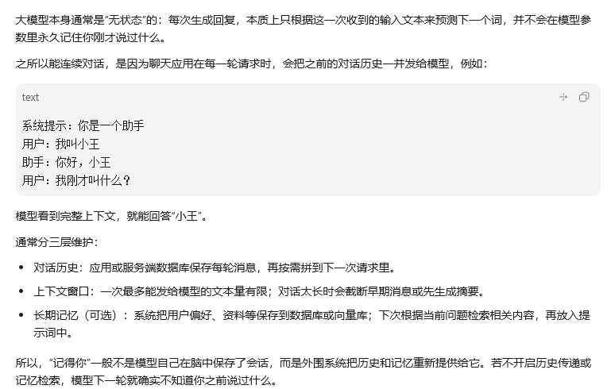

## 消息

消息是模型交互的基本单元，通过角色roal分为不同的类型。

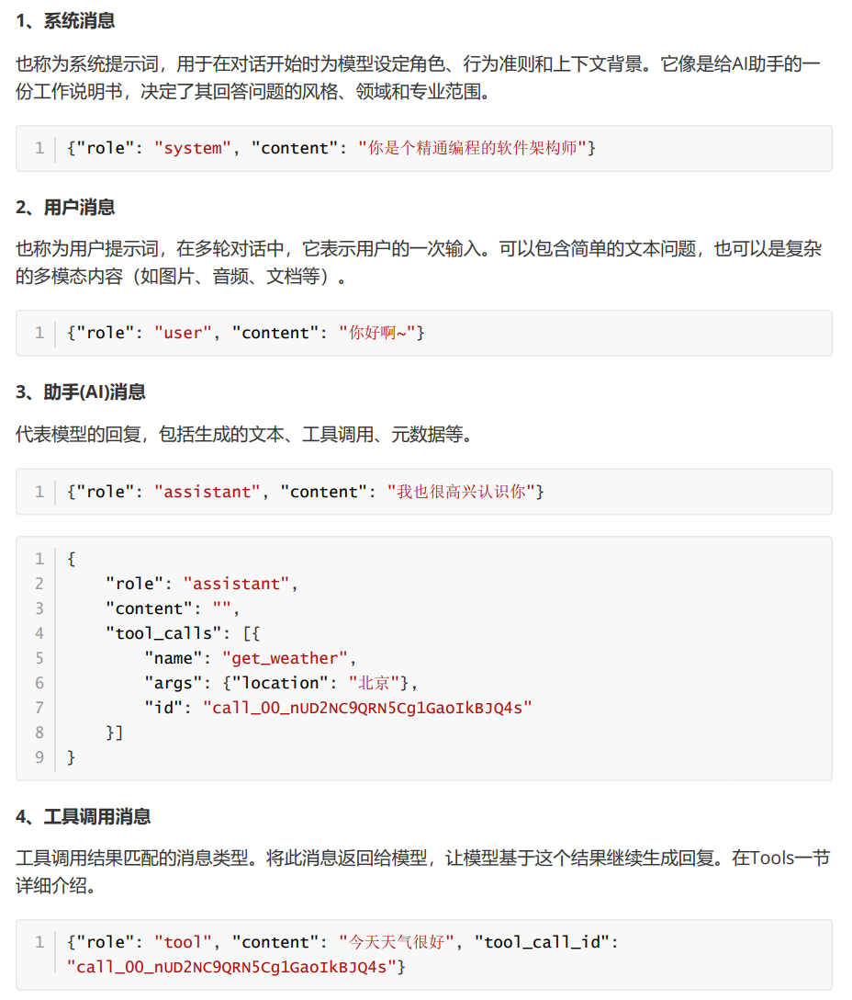


## 消息拓展属性

### content/content_blocks

content:数据内容，支持文本和列表，可以是字符串，也可以是图片

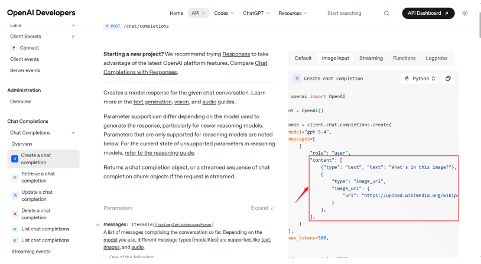

**content_blocks:** 目标是提供有一种跨模型供应商、标准化的多模态数据结构， 兼容content


## 提示词模板

**ChatPromptTemplate**：结构化的，包含多种元数据的消息列表已经取代了单一字符串，成为与模型交互的标准数据格式。

**模型的输入输出都是结构化的消息列表**，使用提示词模版，预先设置部分提示词，设置场景和角色。

支持 三种方式填充内容 invoke() 、 format() 、 format_messages()

```python
#参数类型这里使用的是tuple构成的list
prompt_template = ChatPromptTemplate([
	# 字符串 role + 字符串 content
	("system", "你是一个AI开发工程师. 你的名字是 {name}."),
	("human", "你能开发哪些AI应用?"),
	("ai", "我能开发很多AI应用, 比如聊天机器人, 图像识别, 自然语言处理等."),
	("human", "{user_input}")
])
#方式1：调用format()方法，返回字符串
prompt_value = prompt_template.format(name="小谷AI", user_input="你能帮我做什么?")

######结合提示词，调用大模型#########
# 得到模型的输出
output = model.invoke(prompt_value)
# 打印输出内容
print(output.content)

```


### 部分变量预填充 partial()

预填充某些固定不变的变量，创建模板的变体。 

**使用场景：** 某些变量在所有调用中都相同 需要为不同用户/场景创建定制模板

```python
from langchain_core.prompts import ChatPromptTemplate
# 原始模板
template = ChatPromptTemplate.from_messages([
("system", "你是{role}，目标用户是{audience}"),
("user", "{task}")
])
# 部分填充
customer_support_template = template.partial(
role="客服专员",
audience="普通用户"
)
# 现在只需要提供 task
messages = customer_support_template.invoke({"task":"解释退款政策"})
print(messages)

```


### 消息占位符

partial()只能填充部分变量，如果是在特定位置**插入消息列表**，

**使用场景**：多轮对话系统存储历史消息以及Agent的中间步骤处理此功能非常有用

##### 方式1：placeholder   JSON形式

```python
from langchain_core.prompts import ChatPromptTemplate
template = ChatPromptTemplate.from_messages(
    [
    ("system", "你是一个有用的AI助手"),
    ("placeholder", "{conversation}"),
    ]
)

prompt_value = template.invoke(
	{
		"conversation": [
            ("human", "你好!"),
            ("ai", "今天我能帮你做什么？"),
            ("human", "你能给我做一个冰激凌吗？"),
            ("ai", "抱歉，我没有这样的能力"),
		]
	}
)
print(prompt_value)
```

##### 方式2：MessagesPlaceholder实例

```python
from langchain_core.prompts import ChatPromptTemplate, MessagesPlaceholder
from langchain_core.messages import HumanMessage
prompt_template = ChatPromptTemplate.from_messages([
	("system", "You are a helpful assistant"),
	MessagesPlaceholder("msgs")
])
prompt_template.invoke({"msgs": [HumanMessage(content="hi!")]})
# prompt_template.format_messages(msgs=[HumanMessage(content="hi!")])
```

# 5、Tools

tools工具是能够支持模型与外部交互的关键能力。注意：**MCP是连接模型应用与外部能力的标准协议，不是模型调用方式。**

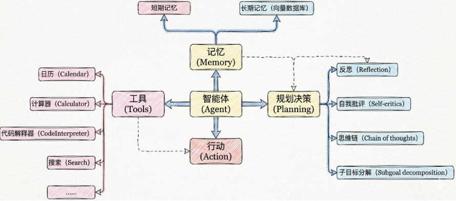


## @tool注解

可以自动将普通Python函数转换为智能体可调用的工具，方式最直接，代码量最少

```python
import os

from dotenv import load_dotenv
from langchain.chat_models import init_chat_model
from langchain_core.tools import tool


# 从 .env 文件中加载环境变量
load_dotenv(override=True)

CLOSEAI_API_KEY = os.getenv("CLOSEAI_API_KEY")
CLOSEAI_BASE_URL = os.getenv("CLOSEAI_BASE_URL")

model = init_chat_model(
    model="gpt-5.4-mini",
    model_provider="openai",
    api_key=CLOSEAI_API_KEY,
    base_url=CLOSEAI_BASE_URL,
)


# 定义工具
@tool
def get_weather(city: str) -> str:
    """获取指定城市的天气。"""
    # 你的实现
    return "晴天，温度 15°C"


# 绑定工具
model_with_tools = model.bind_tools([get_weather])

# AI 可以决定是否调用工具
response = model_with_tools.invoke("北京天气如何？")
# response = model_with_tools.invoke("2 + 3 = ？")

# 检查 AI 是否要调用工具
if response.tool_calls:
    print("AI 想调用工具：", response.tool_calls)
else:
    print("AI 直接回答：", response.content)
```


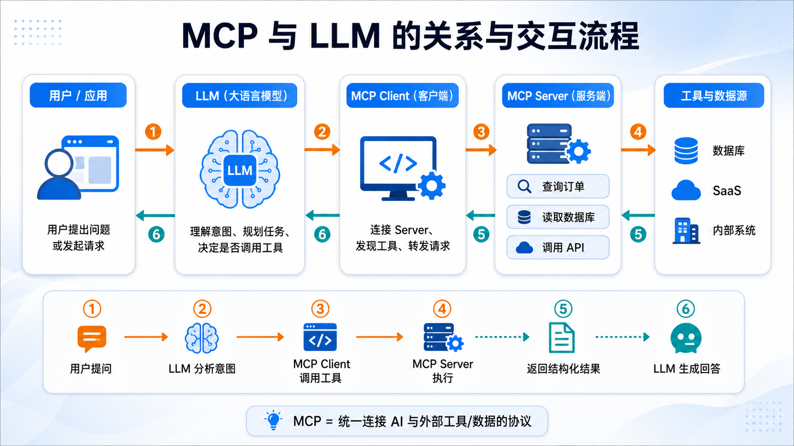


#### convert_to_openai_tool

加载工具的描述信息，指定参数类型已经函数功能。

三个双引号表示开始开始和结束

```python
def get_weather(dt: str, city: str="北京"):
    """
    天气查询工具
    Args:
        dt: 日期
        city: 城市名称
    """
    return f"{city}天气晴朗"
```

### 工具要求

1. 清晰的描述
2. 功能单一
3. 如何处理工具失败
   1. 工具内部处理，避免无效参数处理
   2. Agent级充实，可以在描述中写明，如果调用失败，可以尝试尝试方法解决问题
   3.  配置重试规则：如果失败，最多尝试 3 次（即第 1 次正常调用 + 2 次重试） @retry(stop=stop_after_attempt(3))
4. 结果可返回字符串、字典、artifact或`Command`等协议支持的类型
5. 选择同步vs异步
   - **同步工具**：简单场景，CPU密集型任务
   - **异步工具**：IO密集型


# 6、结构化输出

LangChain的结构化输出（Structured Output） 指的是：模型的输出，而非对用户的输出。

**要求模型最终返回一个符合预定义结构的数据对象**，例如固定字段的JSON、Pydantic 模型、 TypedDict，而不再是无格式的自然语言文本。

**特点：**

- **更容易被代码处理**：下游可以直接读取，而不是从自然语言中再解析
- **结果更稳定**：减少模型解析语义错误导致的整体失败
- **更适合工程化**：适用于表单抽取、分类、路由、调用工具参数生成、工作流状态传递等场景。

**当前模型支持以下几种结构**

- Pydantic（字段校验、描述、嵌套结构，功能最丰富） 

- TypedDict（轻量类型约束） 

- JSON Schema（与前后端/跨语言接口最通用） 

- dataclass 

  

**模型对象可以调用 with_structured_output() 绑定输出模式（schema）。**

## Pydantic

通过运行时校验保证结构、类型及显式约束，但不能保证内容或事实正确，是**生产场景首选**。

**需要满足的几个要素**：

- 使用Pydantic定义结构化输出时，数据模型需要继承 BaseModel
- 使用 类型提示 。Pydantic 支持丰富的字段类型：str 、int、float、List[xxx]、Optional[xxx]等 
- 使用 Field() 添加字段默认值和描述，帮助 LLM 理解字段含义


**使用场景**：调用模型之前，先指定返回结果格式

```python
class Person(BaseModel):
    """人物信息"""
    name: str = Field(description="姓名")
    age: int = Field(description="年龄")
    occupation: str = Field(description="职业")

# 创建结构化输出的 LLM
structured_llm = model.with_structured_output(Person)
# 调用
result = structured_llm.invoke("张三是一名 30 岁的软件工程师")
print(result)
print(type(result))
# result 是 Person 实例
print(result.name) # "张三"
print(result.age) # 30
print(result.occupation) # "软件工程师"
```

**高级特性**

- Optional ：指定某个字段可选，非必须返回值
- Field(default="默认值", description="描述")：默认值
- **枚举**：属性定义为枚举：
  - \# 使用 Literal 直接限定字面量值 urgency: Literal["低","中","高"] = Field(description="紧急程度")
- 列表，定义属性为List
- 对象嵌套：属性是一个额外的对象属性，非基础字段，建议嵌套层级<=3
- 限制条件

**执行流程**：

1. 定义Pydantic结构
2. 协议转换：定义数据结构后，通过Pydantic的底层方法，将对象转换为标准的JSON Schema。
3. 模型交互与约束：根据模型能力选择原生结构化输出、Tool Calling或其他JSON输出方式；约束强度由供应商和策略决定。
4. 解析与验证：对模型返回结果进行解析和Schema校验，失败时按策略报错或重试。

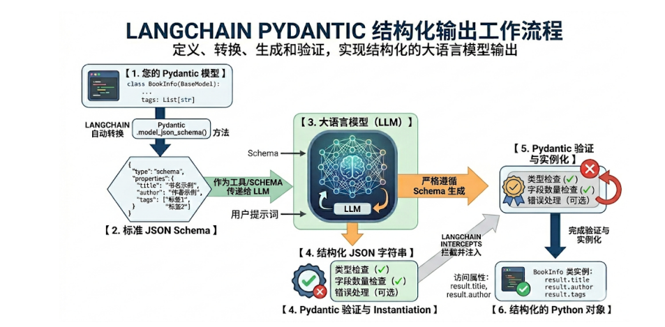

## TypedDict

**即带有类型声明的字典结构**，适合快速定义字典结构且无需Pydantic重量级的场景。

**TypedDict主要是类型声明，不是运行时强校验器。**是否执行运行时校验取决于Provider和具体执行路径。


```python
from typing import TypedDict, List, Annotated
    # 使用TypedDict定义嵌套结构
class Actor(TypedDict):
    """演员情况"""
    name: Annotated[str, "演员姓名"]
    role: Annotated[str, "饰演的角色"]

class Movie(TypedDict):
    """电影情况"""
    title: Annotated[str, "电影标题"]
    year: Annotated[int, "上映年份"]
    director: Annotated[str, "导演"]
    cast: Annotated[List[Actor], "演员列表"] # 嵌套列表定义
    rating: Annotated[float, "评分"]

```


## JSON  Schema

JSON Schema本身具有校验语义；直接使用原始Schema字典较繁琐，是否完整校验取决于Provider和解析路径。

## @dataclass

@dataclass是Python标准库提供的类装饰器，自动生成常用方法，近似于手写这些方法的普通类。

- `__init__`
- `__repr__`
- `__eq__`

```python
@dataclass
class Movie():
    """
    电影的详细信息
    """
    title: str = Field(description="电影标题")
    year: int = Field(description="电影上映年份")
    director: str = Field(description="导演")
    rating: float = Field(description="电影评分，满分十分")
    
structured_model = model.with_structured_output(Movie)
response = structured_model.invoke("给出盗梦空间的信息")
```


# 7、Agent

Agent的关键任务：理解用户问题、如何拆解任务、判断是否需要工具、需要哪些工具、输入根据工具结果生成回答&推进任务。

最核心的两个能力：**工具**和**记忆**

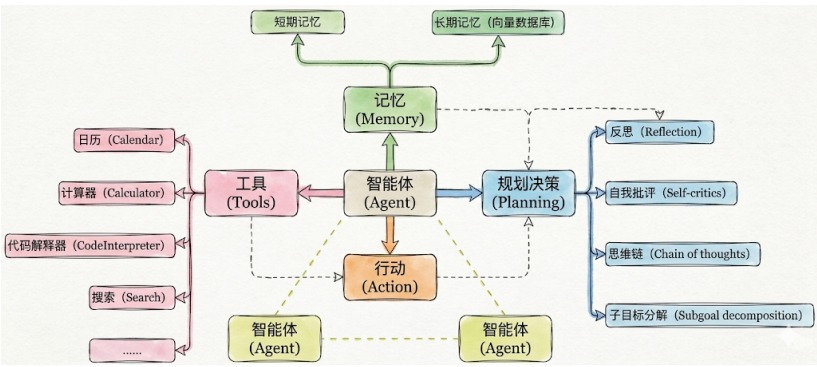


### Agent创建

创建一个agent本质上是LangGraph的**CompiledStateGraph**实例，底层实现是一个图结构。

Agent在创建时，涉及到模型、可调用工具、系统提示词等信息。

```python
from langchain.agents import create_agent
agent = create_agent(
    model=model,                  # 聊天模型
    tools=tools,                  # 工具列表
    system_prompt="你是一个可靠的助手",
    middleware=[],
    interrupt_before=None,
    interrupt_after=None,
    debug=False,
    name="assistant",
)
```

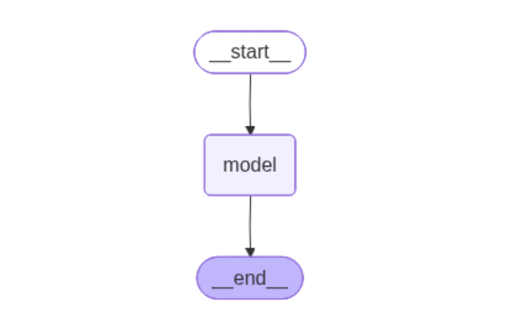

### Agent调用

**Agent的输入和输出都是messages字段的消息列表**

“ {"messages": [{"role": "...", "content": "..."}]} ”

```python
# response 是字典类型
{
    "messages": [
        HumanMessage(...), # 用户问题
        AIMessage(...), # AI 工具调用
        ToolMessage(...), # 工具返回结果
        AIMessage(...) # 最终回答 ← 通常取这个
    ]
}

```

LangChain对工具的使用可以形成**ReAct结构**，即`决策-行动-观察`的控制循环。

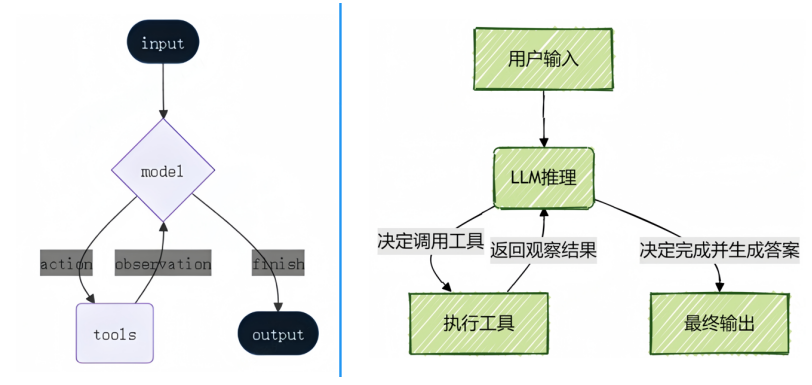

模型在返回调用工具时，可以一次返回多个工具的调用，AImessage返回多个工具的调用，调用完成后返回大模型请求结果。

```json
tool_calls=[
    {
        'name': 'get_weather',
        'args': {'city': '杭州'},
        'id': 'call_w9ARuAgN8iqfG2GR7gv00iBq',
        'type': 'tool_call'
    },
    {'name': 'get_news', 'args': {}, 'id':
    'call_vOLekRymIme8bWuVQdIew4vu', 'type': 'tool_call'}
]
```

**工具选择：**

大模型根据问题的内容、每个工具的描述、自动选择最匹配的工具。

### Agent命名

创建Agent时可以指定名称，返回AIMessage中带有**Name**信息

```python
agent = create_agent(
	model=model,
	name = "chat_assistant"
)

```

**使用场景**

- 流式输出通过name可以标识是哪个agent的输出
- 消息身份标记：AIMessage携带Agent的name，使它在保存会话记录、回放执行过程、构建审计日志时能够明确识别消息的生产者
- 调试和trace可读性方面，可以帮助开发者快速识别是哪个agent
- 组件化封装：工程实践中，Agent被封装为可复用的能力模块，设置名称方便保持一致的身份标识

### Agent系统提示词

创建agent时可以传入系统提示词，提示词为Agent 提供了任务背景、行为准则和操作指南。AIMessage返回时没有返回SystemMessage


### Agent的结构化输出

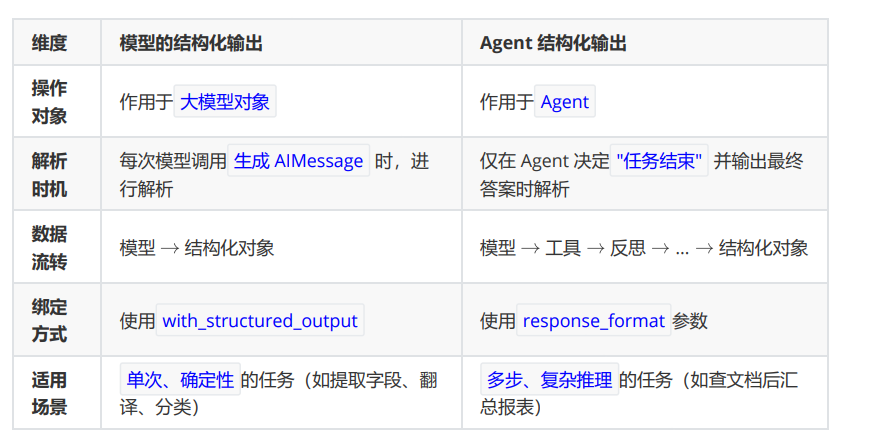

LangChain的create_agent()函数自动处理结构化输出的全过程。用户只需通过 `response_format`参数设置期望的输出模式（Schema）。

 当模型生成结构化数据时，系统会自动捕获、验证并将结果存储在Agent状态的 `structured_response` 键中。

#### ToolStrategy

当前模型兼容绝大部分模型，

**目的是**在模型生成最终答案时，系统会引导模型间接产生符合要求的结构化数据结果。

ToolStrategy通过 工具调用 （Tool Calling/Function Calling）实现结构化输出，所以LangChain会在 消息列表末尾 追加一条ToolMessage ，让整个链路完整。但实际上没有实际的工具执行，这是一条伪 消息。

受限于模型能力，大模型输出的内容可能并 不符合格式要求 ，ToolStrategy通过其 handle_errors参 数 提供了结构化过程错误处理策略，以下是主要的几种方式及其用途：

- handle_errors=True：LangChain默认方式，捕获相关异常，并使用内置错误消息提示模型重试；重试仍可能失败，不能确保最终得到有效数据。
- handle_errors=False：关闭自动重试机制，任何异常都会 直接抛出 ，会 中断程序 运行。 
- handle_errors="自定义字符串"：捕获所有异常，但使用开发者 预设的固定字符串 作为错误消 息。适用于需要统一、友好的用户提示，或进行特定业务引导的场景。 
- handle_errors=ExceptionType：仅 捕获指定类型(如ValueError) 或元组中的异常类型并进行重 试， 其他异常直接抛出 。适用于需要 精准控制 ，只对特定错误进行重试的场景。 
- handle_errors=callable：灵活性最高的方式，使用开发者 自定义的函数来处理异常 ，可根据不 同的异常类型返回差异化的提示信息。适用于需要复杂、精细化错误处理的场景。


# 8、中间件

## 介绍

Middleware(中间件)，简单说就是Agent 执行过程中的钩子函数，开发者可以高度定制和控制Agent运行的每一个环节。

**没有中间件时：**

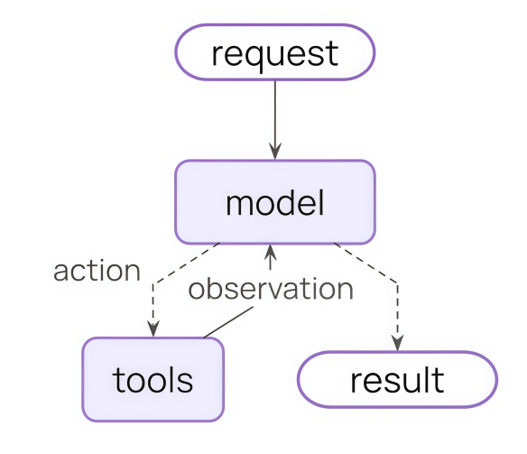

**有中间件后**：

在模型调用前、调用后、在工具调用前、工具调用后

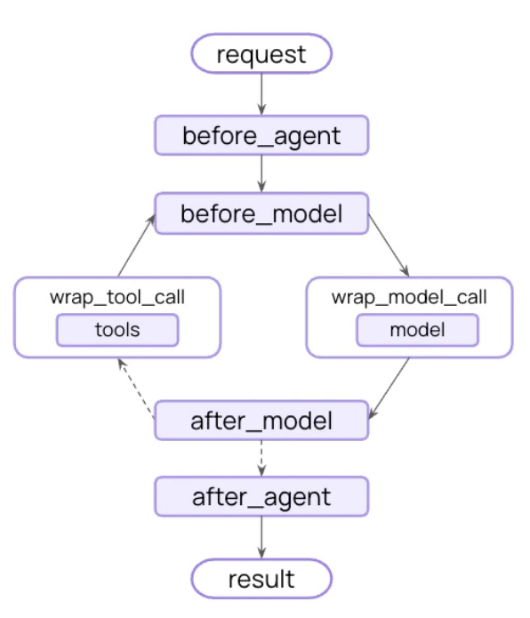

**它们不是 Agent 的核心业务逻辑，但又会影响 Agent 的执行过程。**没有中间件可能遇到的问题:

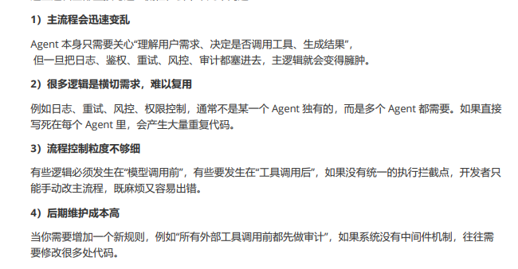

因此，Agent能够**把这些与业务无关的、但与执行过程强相关的横切逻辑，从Agent主流程中抽离出来，**让Agent主体代码**聚焦业务**，借助中间件，实现‘‘**拦截流程，修改流程，增强流程**’’。

可以自定义中间件，也可以使用LangChain提供的一些常用中间件。

- 成本统计和控制类
  - Model call limit：限制模型调用次数，防止一次任务反复请求 LLM，导致费用失控 
  - Tool call limit：限制工具调用次数，避免 Agent 无限试错、死循环调工具
  - Summarization：在上下文快满时自动总结历史，减少 token 消耗 
  - Context editing：裁剪上下文、清理工具调用痕迹，本质上也是为了节省上下文成本

适用于：控制成本、配额治理、长会话优化、以及产品控费等

- 稳定性与容错保障类
  - Model fallback：主模型失败时切换备用模型 
  - Model retry：模型调用失败后自动重试 
  - Tool retry：工具调用失败后自动重试

适用于：生产系统中高可用，容灾，鲁棒性建设

- 安全和合规风控
  - Human-in-the-loop：在关键工具调用前暂停，等人工审批 
  - PII detection：检测和处理个人敏感信息 
  - Model call limit / Tool call limit：某种意义上也可归到风控，因为它能防止异常滥用

- 执行能力拓展
  - Shell tool：给 Agent 持久 shell，会执行命令 
  - File search：给 Agent 文件搜索能力，能做 
  - Glob/Grep Filesystem：给 Agent 文件系统读写与长期存储能力

适用于：解决Agent只能聊天，不能真正操作环境


##  SummarizationMiddleware中间件

作用是：对历史消息进行总结&摘要，达到压缩上下文的效果

原理：在达到触发条件后，调用大模型对历史消息进行摘要，**将摘要结果作为HumanMessage，放在消息列表最开始的位置。用一条摘要消息替换旧消息，保留 `keep` 指定的最近消息，原样继续发送给模型。**

参数1：model —用于摘要的模型 可以是模型名称也可以是模型对象，如果传递的是模型名称，底层会调用 init_chat_model 初始化模 型。 

参数2：trigger —摘要触发条件 是一个列表，每个元素对应一个条件，当 任一条件满足 时，触发摘要。

1. tokens ：token的数量，历史token的累计数量达到该值触发摘要。 
2. messages ：历史消息数量，历史消息条数达到该值触发摘要。
3. fraction ：上下文长度比例。历史token的累计数量达到模型的 max_input_tokens*fraction 触 发摘要

参数3：keep —摘要时保留的原始消息 

支持三种条件，但和trigger不同，keep同一时间只接收一种条件。 

1. tokens ：摘要时保留的token数量。 
2. messages ：摘要时保留的历史消息条数。
3. fraction ：摘要时保留 max_input_tokens*fraction 个token。


**与Codex的区别**：

LangChain 是可明确配置的“摘要旧消息 + 保留最近 N 条”；Codex 也是摘要压缩，但保留策略更偏内部的任务连续性管理，不保证固定保留最近几条。

## hook

钩子函数，实现自定义中间件。类似AOP的方法，在某个特定的时机，被框架、系统或者主程序自动调用的拓展函数。无论是官方或者自定义中间件都是实现截图中的一个或者多个hook节点实现的。

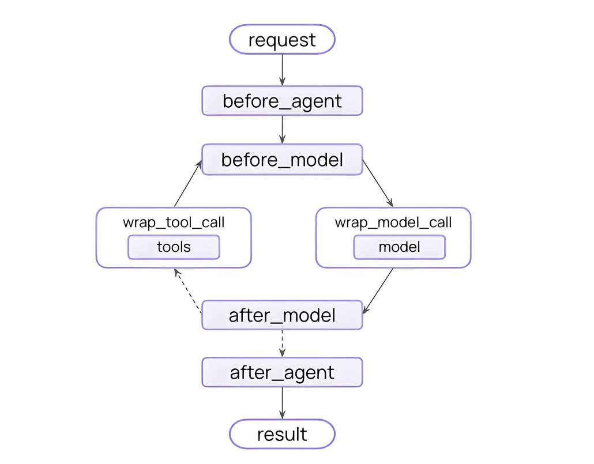

**Node-style hooks(节点风格钩子)**

在流程的特定节点运行：before_agent、before_model、after_model、after_agent

**Wrap-style hooks(包装风格钩子)**

在模型或者工具调用前后：wrap_model_call (包裹模型调用) wrap_tool_call (包裹工具调用)


### Node-style hooks

参数：

**state**: 是一个AgentState实例，维护Agent运行过程中的状态，这类状态会随着Agent的运行而发生变化，包括 消息列表 。 

**runtime**: 是一个Runtime实例，维护Agent运行过程中的上下文环境，包括 上下文 、 长期记忆 等。

**返回值**

- None：不修改状态
- 返回 {"jump_to": "..."}：跳转到其他节点


#### **函数用法**

装饰器是函数式挂载，把一个hook快速挂载到Agent的某个节点。在中间件方法增加注释，装饰器底层会基于重写的方法构造一个 **AgentMiddleware子类** 的实例，

**装饰器实现原理：**

1. 创建一个AgentMiddleware的子类 
2. 类名为middleware_name，即创建agent时传递的中间件名称，上述案例中是 after_model_middleware
3. 这个子类有两个属性 state_schema 和 tools 
4. 有一个方法： after_model ，逻辑等同于 func(state, runtime) 。
5. 最后的括号 () 表示实例化子类，返回一个对象

```python
GeneratedMiddleware = type(
    middleware_name,
    (AgentMiddleware,),
    {
        "state_schema": state_schema or AgentState,
        "tools": tools or [],
        "after_model": func,
    },
)
middleware = GeneratedMiddleware()
```


**反例（仅用于观察Hook顺序）**

```python
# 1. 定义 before_model 钩子
@before_model
def before_model_middleware(
    state: AgentState,
    runtime: Runtime,
) -> dict[str, Any] | None:
    state["messages"][-1].content += " -> before_model <- "
    return None


# 2. 定义 after_model 钩子
@after_model
def after_model_middleware(
    state: AgentState,
    runtime: Runtime,
) -> dict[str, Any] | None:
    state["messages"][-1].content += " -> after_model <- "
    return None


# 3. 定义 before_agent 钩子
@before_agent
def before_agent_middleware(
    state: AgentState,
    runtime: Runtime,
) -> dict[str, Any] | None:
    state["messages"][-1].content += " -> before_agent <- "
    return None


# 4. 定义 after_agent 钩子
@after_agent
def after_agent_middleware(
    state: AgentState,
    runtime: Runtime,
) -> None:
    state["messages"][-1].content += " -> after_agent <- "
    return None


agent = create_agent(
    model=model,
    middleware=[
        before_model_middleware,
        after_model_middleware,
        before_agent_middleware,
        after_agent_middleware,
    ],  # 👈 添加中间件
)
```

> 生产代码不要原地修改State或Message；需要持久更新时应返回State Update，并由Reducer合并。


#### **继承类实现**

1. 必须继承 AgentMiddleware ← 这个固定 
2. 方法名固定 ( before_model , after_model ) ← 这个固定 
3. 类名随意 ← 这个不固定


```python
class MyMiddleware(AgentMiddleware):
    def __init__(self) -> None:
        super().__init__()

    def before_model(self, state: AgentState, runtime: Runtime) -> dict[str, Any] | None:
        state["messages"][-1].content += " -> before_model <- "
        return None

    def after_model(self, state: AgentState, runtime: Runtime) -> dict[str, Any] | None:
        state["messages"][-1].content += " -> after_model <- "
        return None

    def before_agent(self, state: AgentState, runtime: Runtime) -> dict[str, Any] | None:
        state["messages"][-1].content += " -> before_agent <- "
        return None

    def after_agent(self, state: AgentState, runtime: Runtime) -> None:
        state["messages"][-1].content += " -> after_agent <- "
        return None


my_middleware = MyMiddleware()

agent = create_agent(
    model=model,
    middleware=[my_middleware],
)
```

### Wrap-style hooks

装饰器模式：@wrap_model_call

基于类实现：继承AgentMiddleware

和Node-style hook相似。**场景用于：拦截、重试、缓存模型的调用等。**

```python
class WrapModelCallMiddleware(AgentMiddleware):
    def wrap_model_call(self, request: ModelRequest, handler: Callable[[ModelRequest], ModelResponse]) -> ModelResponse | None:
        request.messages[-1].content += " -> wrap_model_call_before <- "

        response = handler(request)

        response.result[0].content += " -> wrap_model_call_after <- "
        return response


agent = create_agent(
    model=model,
    middleware=[WrapModelCallMiddleware()],
)
```


装饰器和类的选择 

- 装饰器写法适合把单个 hook 快速挂到 agent 生命周期的某个节点上； 
- 类写法更适合把多个 hook 组织为一个完整的中间件组件； 
- 当中间件同时涉及 before_model 、 after_model 等多个钩子时，虽然装饰器工厂也能实现，但 类写法在结构表达、配置归属、可维护性上更好。


装饰器写法更适合单个 hook、逻辑简单、快速原型的场景； 类写法更适合多个 hook 组合、复杂配置、需要同时提供同步/异步实现、以及更强复用与可测试 性的场景；


# 9、上下文与记忆

大模型是无状态的，不会记忆上下文，所以需要记忆模块去保存我们和模型对话的上下文信息，在下次请求时把历史信息都输入给模型，让模型输出结果。

记忆(Memory) 模块：核心作用是「 保存上下 文 」和「 提供上下文 」

LangChain提供了三种管理上下文的方法：

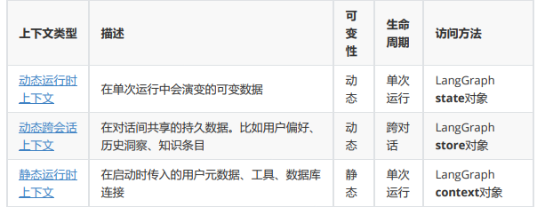

动态运行时上下文：本次运行所需且通常不变的依赖信息，不等于短期记忆

动态跨会话上下文：长期记忆

- 短期记忆（Short-term memory、会话级记忆、thread-scoped memory）：作用范围是单个对话线程（Thread）内；更换`thread_id`后不会自动加载旧线程记忆，但旧Checkpoint并未因此删除。
- 长期记忆（Long-term memory，跨会话级记忆）：在会话间存储用户特定或应用级数据，并可按namespace、身份和权限在多个线程间共享。

在LangChain中：Agent是构建在LangGraph图结构上的，通过state和store构 建记忆系统。使用更简单、功能更统一。 

- state：短期记忆对象，以 会话 为单位组织，包含当前会话的所有消息记录以及自定义信息。 
- store：长期记忆对象， 跨会话持久化 的数据，通常需要结合向量数据库或外部存储实现。


## 短期记忆

短期记忆是三者的组合：

State（会话内部状态） + Checkpointer（持久化机制） + Thread ID（会话作用域）

- State ：默认 存储历史消息列表messages ，通过State 管理历史消息 
- Checkpointer ：负责将State 作为检查点持久化保存，检查点是某个时刻的State 快照 （不是任何时刻都存储，而且到关键节点才会存储）
- Thread ID：标识一条执行线程或时间线，运行时会按照`thread_id`读写其Checkpoint；具体State快照还由`checkpoint_id`区分

短期记忆的实现：

不必自己手动把所有的请求和返回Message进行组装，state会自己组装。


1. 第1步：初始化记忆引擎： checkpointer = InMemorySaver() ——创建一个内存级的记忆存储。 注意：InMemorySaver内存中保存，进程结束就丢失数据，适合测试。**生产环境可换成数据库持 久化的 SqliteSaver 、 PostgresSaver 等** 
2. 第2步：绑定 Agent：在 create_agent 时传入 checkpointer ，让 Agent 具备状态存储能力。 **创建Agent时传入InMemorySaver表示开启短期记忆**
3. 第3步：设定会话 ID：通过 config = {"configurable": {"thread_id": "1"}} 为每次调用指定线程标识。 同一个 thread_id 共享记忆，不同 thread_id 完全隔离。**会话时传入指定会话ID，即可共享当前会话的记忆，不同会话ID是隔离的**

**latest_state = agent.get_state(config)**可以获取配置中会话的所有短期记忆信息。

短期记忆不配置数据库方式:

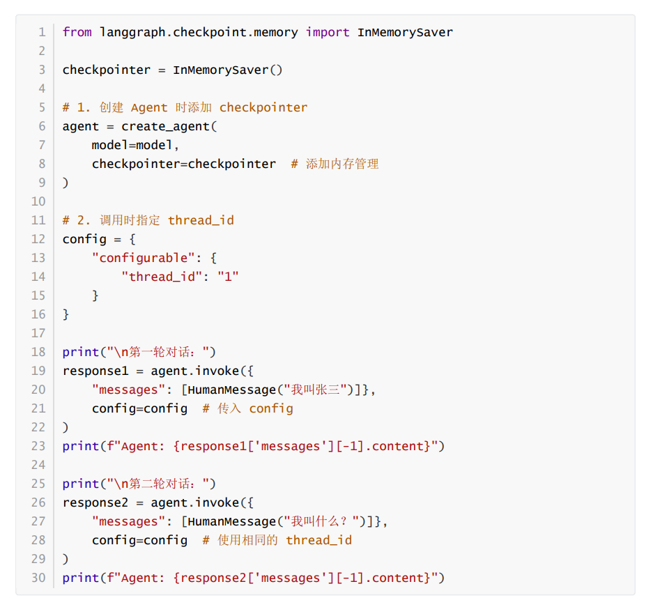


### 短期记忆的存储

配置数据库方式：**增加了数据库的初始化，实际连接能力都是langgraph已支持的。**

**总结**： 

1. InMemorySaver()将状态持久化到内存， 进程结束或重建Saver() 则历史状态丢失 
1. 基于外部存储介质（如PostgreSQL）的持久化器，其存储的状态不会随进程终止而丢失，只要 不 显式删除历史状态 ，即可通过 thread_id 加载历史状态。


Checkpointer：可以配置数据库url指定数据库，连接初始化数据库时会建必要的表（首次连接会创建，重复连接不会再创建）

- checkpoints ：这是主表，存每个 thread 在某个时刻的 checkpoint 快照。 
- checkpoint_blobs ：这张表专门存不适合直接内联进 checkpoints.checkpoint 的较复杂 channel 值。 
- checkpoint_writes ：这张表存的是中间写入 / pending writes，不是最终完整 checkpoint。 
- checkpoint_migrations ：这张表不是业务数据表，而是迁移版本表。


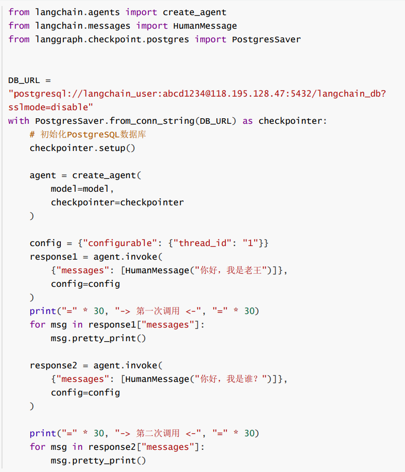


## 长期记忆

**长期记忆的判断标准不是“是否存在数据库”，而是信息能否跨会话持久保存，并在后续任务中被 Agent 重新读取、影响决策。**

**都属于长期记忆。长期记忆不会像系统提示词一样直接塞到会话上下文中，而是在新会话或每一轮请求，进行检索一部分，把命中的内容注入到上下文**

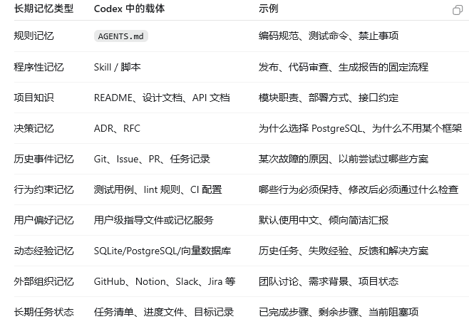

**是否自动传入上下文**：

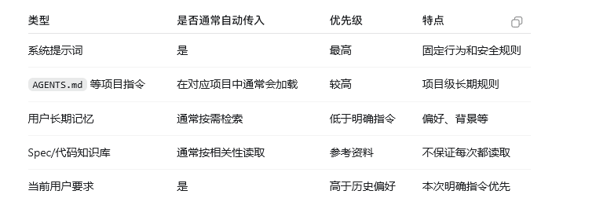


短期记忆是会话级数据，长期记忆可跨Thread共享，但仍受namespace、身份和权限控制。

长期记忆的存储是 store -> namespace -> key -> value 的四层架构。**类似文件目录的层级结构**

- Store（记忆仓库）
  - Store是 langgraph.store.base.BaseStore 的子类实例，由全类名可知，store是由LangGraph提 供的。 常用实现类： 
    - InMemoryStore ：将长期记忆存储在内存，适合测试 PostgresStore ：将长期记忆存储在外部的
    - PostgreSQL数据库，适合生产环境 开发期可用 InMemoryStore；生产建议数据库后端，如 PostgresStore
- Namespace（命名空间）
  - 数据类型是由任意长度的 tuple[str, ...] 表示的 层级路径（tuple元组是不可变的List） 。作用上很像“文件路径 / 文件夹层级”，用于 给长期记忆分组和隔离。数据类型为 字符串元组
- Key
  - 是该 namespace 下的唯一标识，单条记忆的唯一键，数据类型为 字符串(str)
- Value
  - 是存储的值，数据类型为 字典(dict[str, Any])


```python
namespace = ("users", "user_123", "preferences") # 元组类型
key = "profile" # 字符串类型
value = { # 字典类型
"language": "zh-CN",
"style": "short_direct",
"likes": ["python", "rag"]
}
store.put(namespace, key, value)
```


对于长期记忆的store持久化数据，支持put、get、search，可以在Agent执行**流程之外**直接访问长期记忆

**put函数**

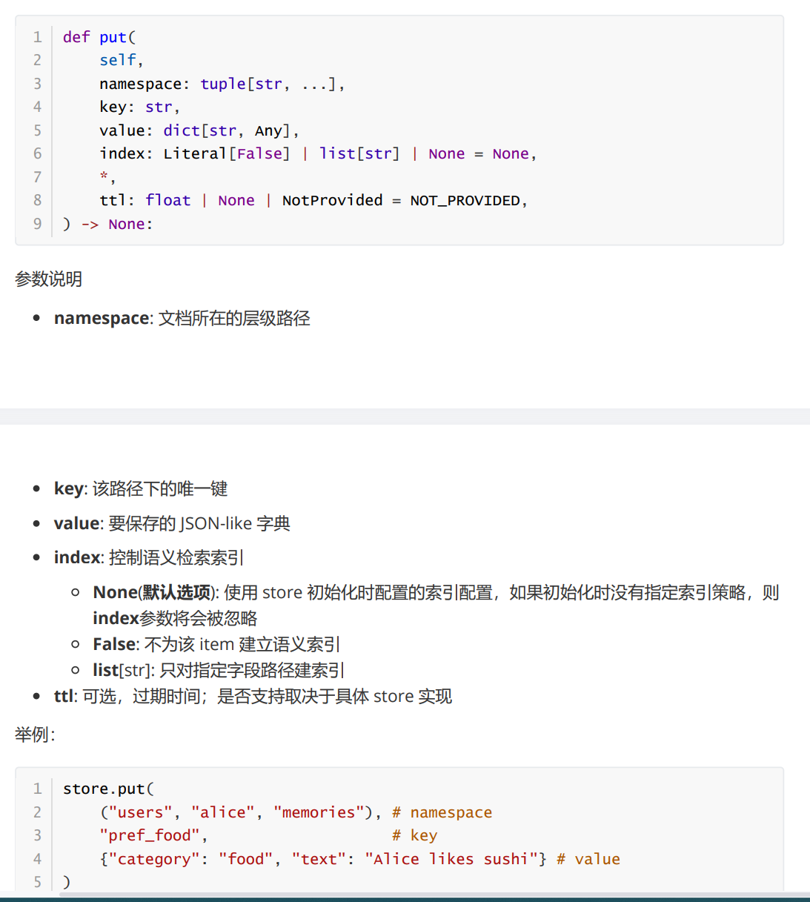

**get函数**

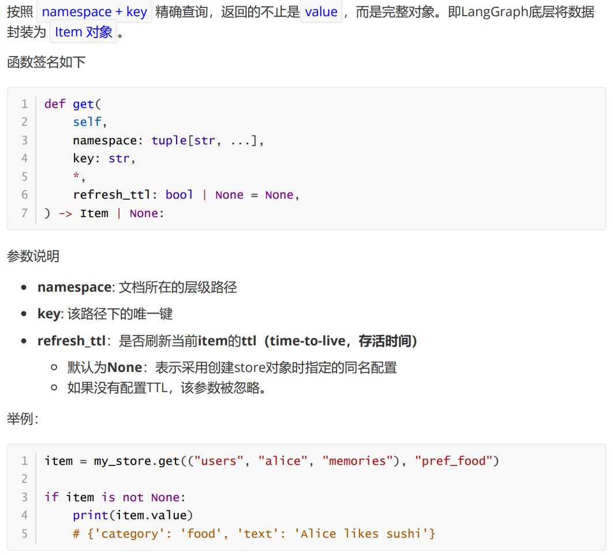

**search函数**

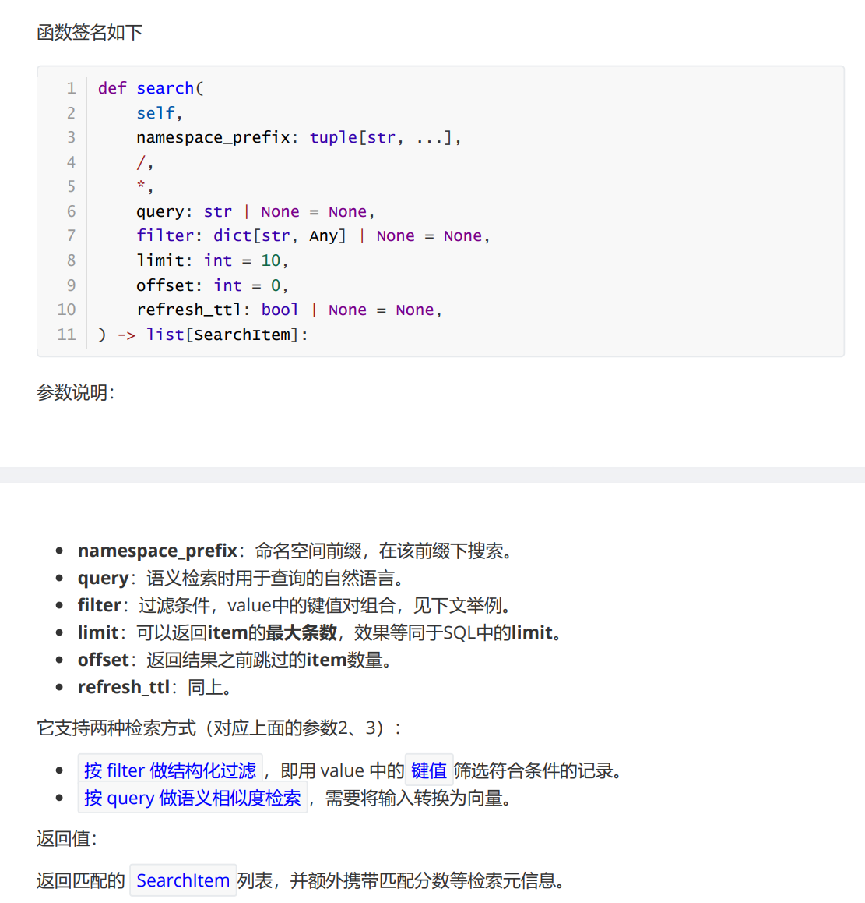


# 10、RAG

## 概述

RAG（Retrieval-Augmented Generation，检索增强生成）是一种结合信息检索（Retrieval）与 文本生成 （Generation）的技术，旨在提升大语言模型在回答专业问题时的 准确性 和 可靠性 。

**大模型的局限性：**

- 知识滞后：LLM训练数据有截止日期，无法及时反应最新的信息或者动态变换
- 知识缺失：模型训练依赖网络公开的数据，而某些特定领域的（企业内部资料、专有技术文档）或者私有数据是缺失的，导致模型无法生成准确回复或者虚构
- 幻觉：LLM 回答时可能胡言乱语，“幻觉”可以体现为错误陈述、 编造事实、错误的复杂推理或者复杂语境下理解能力不足等
  - **幻觉产生的原因：**
    - 训练知识存在偏差：错误信息被LLM学习后复现
    - LLM训练时被过度泛化，将普通模式应用到特殊场合导致不准确输出
    - LLM缺乏某些领域的相关知识，导致在面临这些领域问题时编造

因此，可以将检索到的文档和提示词输出给大模型，生成更加可靠的答案。引用场景有：客服系统、基于大模型的数据分析、以及聊天应用。

**RAG优点：**

- RAG可以提供更加丰富的上下文和数据样本，可以不需要用户提供过多的背景描述，就会能生成比较符合客户预期的答案。
- RAG可以提供文档问答内容的时效性和可靠性（相较于增加数据训练、微调模型 是时效性高的）
- 在一定程度上保护了业务数据的隐私性

**RAG缺点：**

- 每次回答都涉及外部系统的数据检索，RAG响应时延相对较高
- RAG增加了大量token消耗


**检索流程**：

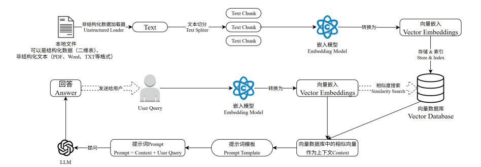


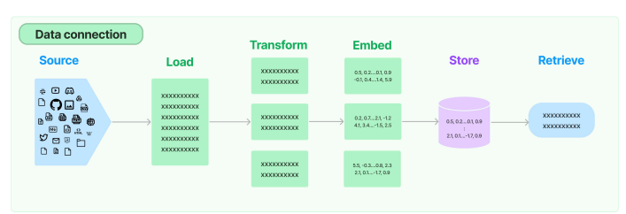

1. Source 数据源
   1. 原始数据可以是多种类型：文本、图片、代码、视频等
   2. 形式可以是多样的，比如上百个csv文件、json文档，或者pdf文档，甚至可以以API接口
2. Load（加载）
   1. 文档加载器 负责将不同数据源的非结构化文档，加载到内存，成为文档对象
3. Transform（转换）
   1. 文档转换器(Document Transformers)  将加载的文档进行转换和处理，以便更好的额适应下游任务的需求
   2. LangChain 支持多种转能能力
      - **文本拆分器(Text Splitters)** ：将长文本拆分成语义上相关的小块，以适应语言模型的上下文窗口 限制。 【最重要以及最困难的幻觉，显著影响检索效果】
      - 冗余过滤器(Redundancy Filters) ：识别并过滤重复的文档。 
      - 元数据提取器(Metadata Extractors) ：从文档中提取标题、语调等结构化元数据。 
      - 多语言转换器(Multi-lingual Transformers) ：实现文档的机器翻译。 
      - 对话转换器(Conversational Transformers) ：将非结构化对话转换为问答格式的文档
4. Embed（嵌入）
   1. 将文本转换为向量展示，通过**特定算法**将语义信息编码转换为固定维度的向量，**相似的词在向量空间中距离相近**
   2. 检索能力具体有：
      1. 语义匹配 ：通过计算两个文本的向量余弦相似度，判断它们在语义上的相似程度，实现语义匹 配。 
      2. 文本检索 ：通过计算不同文本之间的向量相似度，可以实现语义搜索，找到向量空间中最相似的 文本。 
      3. 信息推荐 ：根据用户的历史记录或兴趣嵌入生成用户向量，计算不同信息的向量与用户向量的相 似度，推荐相似的信息。 
      4. 知识挖掘 ：可以通过聚类、降维等手段分析文本向量的分布，发现文本之间的潜在关联，挖掘知 识。 
      5. 自然语言处理 ：将词语、句子等表示为稠密向量，为神经网络等下游任务提供输入。
5. Store（存储）
   1. 将向量存储在**向量数据库**，避免重复计算匹配，支持高效的检索和存储
6. Retrieve（检索）


## 文档加载器

常用的加载器有：TextLoader - 文本文件、CSVLoader - CSV 文件、PyPDFLoader - PDF 文件、WebBaseLoader - 网页【都是现有的工具无需过多了解】

## 文档切分器

将Document对象，切分成一个个小块，

- 长文档问题：大模型输入有上下文限制，避免文档太大导致输入被截断
- 检索精度：Document 可能存在与本次检索无关的信息，都作为输入可能会干预结果的生成
- 成本控制：减少不必要的token消耗

###  Chunking拆分的策略

- 根据句子切分：按自然语句进行切分保持语义完整
- 根据固定字符数切分：根据指定的字符数据切分，可能会导致主题或语义上的断裂
- 按固定字符数切换，结合重叠窗口：是前两种策略的结合，固定字符数语句没有完结则按句子切分，保证内容的连贯性
- 递归字符切换方法：灵活高效是首选的策略。
  - 先按空行 `\n\n` 切分，尽量保留完整段落。如果某个段落仍然太长，再按换行符 `\n` 切分。如果仍然太长，再按句号 `。` 切成句子。继续按逗号、空格切分。最后才按单个字符强制切分。
- 根据语义内容切分：旨在保持相关信息的集中和 完整，适用于需要高度语义保持的应用场景。但是效率低，而且处理速度较慢，可能出现：段落长度极度不平和的情况，尽管它在某些需要高精度语义保持的场 景下有其应用价值，但并 不适合所有情况 。

## 向量存储

原本的关系型数据库：Mysql、PostgreSQL可以直接存储元数据信息，**向量数据库可以存储数据的一组特征**

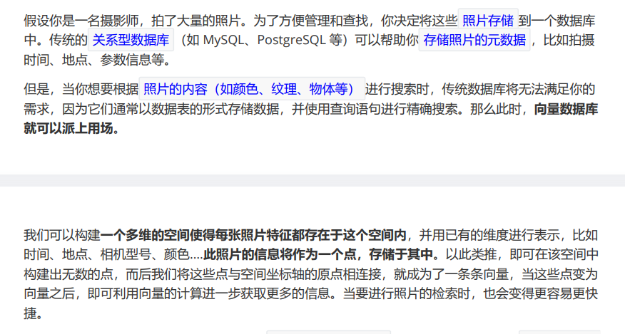

注意：在向量数据库中进行检索时，检索并 不是唯一的、精确的 ，而是查询和目标向量 最为相似的一 些向量 ，具有模糊性。

延伸思考：**只要对图片、视频、商品等素材进行向量化**，就可以实现以图搜图、视频相关推荐、相似宝贝推荐等功能。


# 第一章补充：LangChain整体定位与分层原理

LangChain不是大模型本身，而是构建LLM应用的工程框架。

它解决的重点不是“如何发送一次HTTP请求”，而是多个异构组件如何使用统一协议协作。

## 定位：LangChain解决什么问题

不同模型、工具、检索器和数据库拥有不同的输入输出格式，直接组合会产生大量适配代码。

LangChain通过标准对象和统一接口降低组件之间的耦合：

- Message统一表示系统指令、用户输入、模型响应和工具结果。
- Prompt负责变量填充和消息组装。
- Chat Model Adapter负责转换不同供应商的请求和响应。
- Tool统一描述可执行能力及其参数Schema。
- Retriever统一接收Query并返回Document列表。
- Runnable统一组件的同步、异步、批量和流式调用方式。

**本质：** LangChain在具有概率性的LLM外面，增加了一层相对确定的协议转换和执行控制。

模型负责语义理解、内容生成和下一步决策；框架负责数据转换、流程编排、状态管理、错误处理和Tracing。

## 分层：各组件如何协作

LangChain生态可以分为以下几层：

1. `langchain-core` 定义Message、Prompt、Runnable、Tool和Callback等基础协议。
2. `langchain-openai` 等供应商包把具体模型API适配为LangChain统一接口。
3. `langchain` 提供Agent、Middleware和模型初始化等高层应用抽象。
4. `langgraph` 提供State、Node、Edge、Reducer、Checkpoint和Interrupt等执行能力。
5. `langsmith` 在启用Tracing后接收Run和Trace，并提供评估、实验和生产监控。

`langchain-community` 主要承载社区维护的集成，不等同于所有独立供应商包。

LangChain中的 `create_agent()` 最终会构造并编译一张LangGraph状态图，因此Agent具备循环和状态更新能力；配置Checkpointer后可持久化。

Deep Agents建立在LangChain和LangGraph之上，通过规划、文件系统、Skills和Subagent等能力处理更复杂的长任务。

它们之间的依赖和协作关系如下：

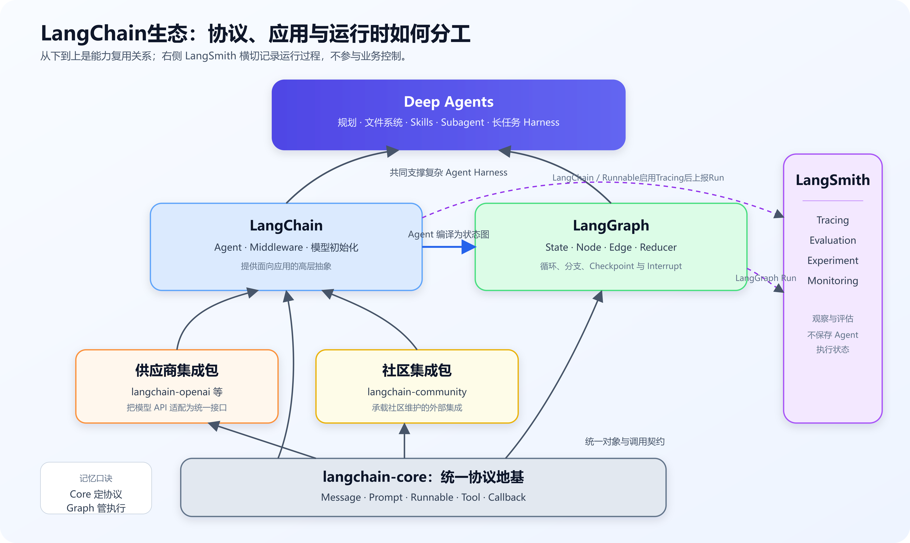

**总结：** LangChain负责应用抽象，LangGraph负责有状态执行，LangSmith负责观察和评估，三者解决的问题不同。

一次普通模型请求通常沿着“Prompt或Message → Model Adapter → 供应商模型 → AIMessage → Parser或Tool路由”流转；固定RAG通常先由Retriever取回文档，再把文档放入Model Context。需要分支、循环和恢复时，再由LangGraph根据State继续调度。启用Tracing后，各层调用会形成父子Run并上报。

## 边界与取舍

LangChain能够统一接口，但不能让能力不同的模型完全等价。

它不会自动保证：

- 模型生成的事实一定正确。
- 模型一定选择正确Tool。
- RAG一定召回相关文档。
- 外部写操作自动具备幂等性。
- Prompt能够代替服务端权限校验。
- 应用自动拥有合理的业务评估标准。

技术选型应按控制需求逐步增加复杂度：

- 单次模型调用使用供应商SDK通常更直接。
- 固定的多组件管道适合Runnable和LCEL。
- 需要状态、分支、循环和恢复时适合LangGraph Workflow。
- 当行动或工具选择需要模型结合上下文动态判断，并且可能形成循环时，适合使用Agent。

**面试重点：** 需要能够说明LangChain的核心价值是“统一协议与执行编排”，并准确区分LangChain、LangGraph、LangSmith和Deep Agents的职责，不能把LangGraph理解成图形化界面，也不能把框架能力等同于模型能力。

# 第二章补充：模型适配与Runnable执行原理

模型调用表面上是发送Prompt并接收回答，底层还包含输入标准化、供应商协议转换、响应归一化和配置传播。

## 模型适配：统一输入与输出

LangChain允许Chat Model接收字符串、由字典、元组或Message对象组成的消息序列，以及PromptValue。

这些输入最终会被统一成消息列表，再由具体模型Adapter转换成供应商协议。

一次调用的底层流程：

1. 输入被标准化为Message列表，常见类型包括System、Human、AI和Tool Message。
2. Adapter读取模型参数、Tool Schema和Response Format。
3. Adapter构造供应商需要的JSON请求。
4. 供应商返回文本、工具调用、Token统计和停止原因。
5. Adapter将结果转换为AIMessage或AIMessageChunk。
6. 公共字段被标准化，供应商特有信息保留在扩展字段中。

`usage_metadata` 是LangChain尽量统一后的Token统计。

`response_metadata` 保存供应商返回的模型名称、停止原因等信息，其字段结构不保证完全一致。

**本质：** 统一Chat Model接口解决的是调用契约一致，不是抹平所有模型的能力差异。

## Runnable与LCEL

Runnable是LangChain组件共同遵守的统一执行协议。

Prompt、Model、Parser和Retriever都可以作为Runnable参与组合。

Runnable统一提供：

- 单次同步和异步调用。
- 批量调用。
- 流式调用。
- 配置和Callback传播。
- Retry、Fallback和Tracing入口。
- 串行、并行和分支组合。

LCEL使用 `|` 等Python语法描述Runnable之间的关系。

`prompt | model | parser` 的本质是构造RunnableSequence，而不是立即执行三次普通函数调用。

执行时，上一个Runnable的输出会成为下一个Runnable的输入，因此前后组件的数据结构必须兼容。

字典在LCEL组合中可以被转换为RunnableParallel，使多个分支接收同一份输入并并发执行。

父Runnable调用子Runnable时，RunnableConfig中的Tags、Metadata和Callbacks会继续传播；启用Tracing后，LangSmith才能据此还原并上报完整调用树。

Runnable的组合关系以及四类执行入口优化的目标如下：

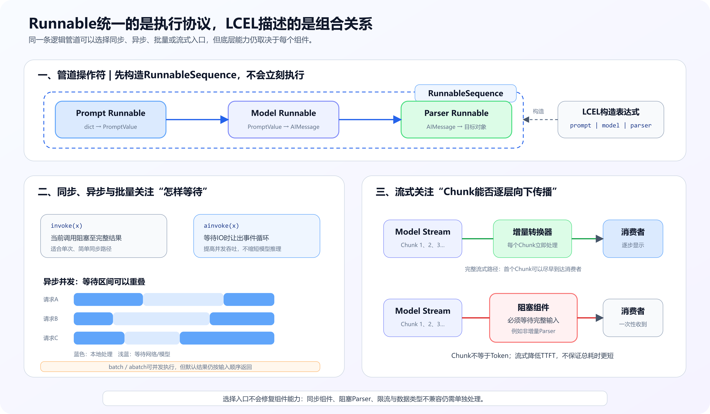

## 同步、异步、批量与流式

`invoke()` 会阻塞当前调用，直到Runnable返回完整结果。

组件有原生异步实现时，`ainvoke()`会在等待IO时让出事件循环；只有同步实现时，Runnable默认通常把`invoke()`放入线程池。两者主要提高并发吞吐量，不代表单次模型推理更快。

`batch()` 和 `abatch()` 用于处理多个互相独立的输入。

Runnable默认的`batch()`在线程池并发调用`invoke()`，`abatch()`并发调用`ainvoke()`；子类也可以覆写实现以利用底层批量能力。Chat Model的`batch()`通常是客户端并发，不能等同于供应商的离线Batch API。

并发数量需要通过 `max_concurrency` 等机制控制，过高会触发限流、连接池耗尽和内存上涨。

流式调用通常经过以下过程：

1. 供应商通过SSE等协议发送增量数据。
2. Adapter把供应商增量转换为AIMessageChunk。
3. 下游Runnable逐步接收并转换Chunk。
4. 应用把多个Chunk聚合成内容完整的AIMessageChunk，再按需消费。

流式输出主要降低首字等待时间TTFT，总生成时间不一定更短。

如果中间Runnable必须等待完整输入，流式传播会在这一层被阻塞。

工具调用参数也可能分多个Chunk到达，JSON尚未完整时不能立即校验和执行。

Agent或LangGraph图级流式还需要区分事件语义：

- `values`返回每个Step后的完整State，`updates`只返回本轮Node产生的局部更新。
- `messages`返回图内模型调用的消息Chunk与Metadata，`custom`由Node或Tool通过Stream Writer主动发送业务进度。
- `checkpoints`、`tasks`和`debug`更适合恢复诊断、任务生命周期和调试，不等同于给用户展示的文本流。
- 同时订阅多个`stream_mode`时，输出会带Mode；`subgraphs=True`还会携带子图Namespace。
- 当前`CompiledStateGraph.stream/astream`的输出封装支持`v1/v2`；其继承的`astream_events()`虽在`langchain-core==1.4.9`签名中接受`v3`，但当前`langgraph==1.1.10`尚未实现，实际应使用`v1/v2`。

## 边界与勘误

不同调用方式共享Runnable协议，但底层实现仍然取决于具体组件和供应商。

**勘误：**

- 正确的异步流式方法是 `astream()`，不是 `asteam()`。
- Chunk是增量片段，不保证一个Chunk恰好对应一个Token。
- 流式输出不会自动暴露模型未公开的私有思维过程。
- `batch()` 默认按照输入顺序返回结果；按完成顺序消费应使用 `batch_as_completed()`。
- `AIMessage.id` 是消息标识，不等于Runnable或LangSmith的Run ID。

Runnable统一了调用方式，但不会自动解决输入输出类型不匹配、供应商限流或模型能力不兼容。

异步适合IO密集型并发；CPU密集型计算不会仅因改成 `async` 自动变快。

**面试重点：** 需要掌握Adapter的双向协议转换、Runnable与LCEL的组合本质，以及同步、异步、批量和流式调用分别优化什么；尤其要区分Chunk与Token、Message ID与Run ID，并说明异步提高的是IO吞吐量而不是模型推理速度。

# 第三章补充：LangSmith可观测与评估原理

LLM应用具有概率性，只查看最终答案无法判断错误发生在Prompt、Model、Tool、Retriever还是Agent路由。

LangSmith通过Tracing记录执行过程，再通过Evaluation衡量应用质量。启用自动Tracing后，框架调用会自动上报；显式使用LangSmith SDK写入Run或执行Evaluation不依赖自动Tracing开关。

## Run、Trace与Thread

Run表示一次独立的工作单元，例如：

- 一次模型调用。
- 一次Tool执行。
- 一次Retriever检索。
- 一次Graph Node运行。
- 一次自定义函数调用。

Run通常记录输入、输出、开始时间、结束时间、错误、Tags和Metadata。

Trace表示一次完整操作产生的Run树。

根Run代表整个请求，模型、工具、检索器等子调用形成子Run。

Thread用于把多轮会话中的多个Trace关联起来。

一轮用户请求通常对应一条Trace，多轮Trace通过相同的 `thread_id`、`session_id` 或 `conversation_id` 组成Thread。

Project是一组相关Trace的容器，通常按照应用、服务或环境划分。

**本质：** Run是执行步骤，Trace是单次操作，Thread是多轮会话，Project是Trace集合。

Project和Thread从不同维度组织Trace，Trace内部再由具有父子关系的Run组成：

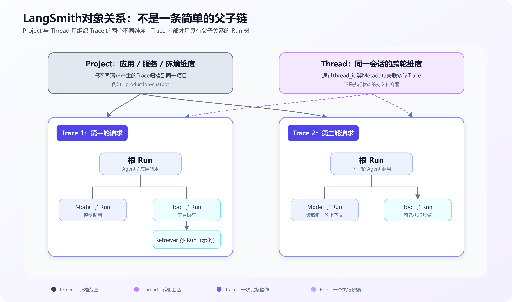

## 自动追踪的底层机制

Runnable调用子Runnable时会传播父级追踪上下文。

启用Tracing后的自动追踪过程可以概括为：

1. 根Runnable开始执行并创建根Run。
2. 子Runnable继承父Run信息、Tags、Metadata和Callbacks。
3. Model、Tool和Retriever分别产生子Run。
4. Callback记录开始、结束、流式事件和异常。
5. LangSmith Client把这些事件组织成Run树并上报。
6. Trace完成后可以在LangSmith中查看完整调用链路。

不属于LangChain的普通Python函数，也可以通过 `@traceable` 或Trace Context手动加入调用树。

未启用自动Tracing时，应用仍可正常执行，框架调用不会自动上报；显式SDK写入仍然可以产生Run和Trace。

Tracing用于观察执行，不应该改变Agent的业务结果。

生产环境需要控制Trace中的敏感数据，Prompt、Tool参数、检索文档和模型输出都可能包含隐私信息。

## 从Tracing到Evaluation

Tracing回答“实际发生了什么”，Evaluation回答“结果是否足够好”。

LangSmith评估包含几个核心对象：

- Dataset：一组相对稳定的测试样本。
- Example：Dataset中的单条输入和可选参考结果。
- Target：真正被测试的Runnable、Retriever、Agent或完整应用。
- Evaluator：根据规则对输出或Trace评分。
- Experiment：某个应用版本在整个Dataset上的运行与评分集合。

Offline Evaluation在发布前对固定Dataset运行，适合Prompt比较、模型升级、Retriever调整和回归测试。

Online Evaluation在已经上报的生产Trace或Thread上运行，适合安全检测、格式校验、延迟监控和无参考答案的质量评估。

完整改进闭环：

1. 生产Tracing发现失败样本。
2. 人工确认错误发生的层次和业务原因。
3. 失败样本加入离线Dataset。
4. 修改Prompt、Model、Tool或Retriever。
5. 运行Experiment比较新旧版本。
6. 通过质量门禁后重新发布并继续监控。

确定性条件应优先使用代码Evaluator，例如JSON能否解析、权限是否正确、Tool参数是否合法。

帮助性、忠实度和语义正确性可以使用人工评估或LLM-as-a-Judge，但Judge本身也需要校准。

Agent评估不能只看最终答案，还应分别检查：

- Tool选择是否正确、参数是否合法、是否出现无效或重复调用。
- 执行轨迹是否到达目标、是否绕路，以及高风险步骤是否经过审批。
- 延迟、Token、工具次数和失败重试成本是否满足预算。
- 同一输入多次运行的成功率与方差；单次正确不能代表Agent稳定。

## 与Checkpoint和Memory的边界

Trace、Checkpoint和Memory保存的内容不同：

- Trace记录自动Tracing或显式SDK上报的执行过程，用于调试、审计和评估。
- Checkpoint保存当前State和下一步位置，用于暂停、恢复和重放。
- Store Memory保存跨Thread需要长期保留的数据。
- Dataset保存稳定测试样本，用于版本比较和回归评估。

LangSmith中的Thread主要负责关联多轮Trace，不会自动保存LangGraph执行状态。

LangGraph的 `thread_id` 可以同时作为Tracing Metadata，但二者共享标识不代表共享存储职责。

删除Trace不会自动删除Checkpoint；保存Trace也不会让Agent自动记住其中内容。

长期记忆只有被应用主动读取并注入模型上下文后，才会影响后续回答。

**总结：** 可观测性、执行持久化和长期记忆分别服务诊断、恢复和跨会话信息管理，不能互相替代。

**面试重点：** 需要准确区分Run、Trace、Thread和Project，说明RunnableConfig与Callback如何在启用Tracing时形成并上报父子调用树，并能够解释Tracing、Checkpoint、Store Memory和Dataset各自保存什么，以及Offline Evaluation如何把线上失败沉淀成可重复验证的回归样本。

# 第四章补充：消息协议、模型无状态与Prompt转换原理

Message是模型上下文的基本数据单元，也是LangChain屏蔽供应商协议差异的核心抽象。

**本质：** LangChain统一消息语义和调用契约，具体请求格式仍由模型Adapter翻译。

## Message统一协议与模型适配

常见Message通过Role表达不同语义：

- `SystemMessage`描述任务、行为和全局约束。
- `HumanMessage`表示用户输入。
- `AIMessage`表示模型响应，也可以携带Tool Call。
- `ToolMessage`表示某次工具调用的执行结果。

Role只是模型协议标记，不是权限系统。SystemMessage不能代替后端鉴权、工具白名单和数据访问控制。

`content`是宽松的内容载荷，可以保存字符串、供应商原生块或LangChain标准块；`content_blocks`提供标准化、类型化访问视图。默认情况下它可以从`content`惰性转换，使用`output_version="v1"`时标准块也可以直接写入`content`。

AIMessage中几个容易混淆的字段：

- `tool_calls`是成功解析的标准化工具调用。
- `usage_metadata`是LangChain尽量统一后的Token统计。
- `response_metadata`保存模型名称、停止原因等供应商响应信息。
- `additional_kwargs`是供应商特有字段的扩展出口。
- `id`是Message ID，不等同于Runnable Run ID。

供应商Response经过Adapter后会被标准化为AIMessage；流式场景产生AIMessageChunk。统一消息协议降低了切换模型的成本，但不会让不同模型的工具、多模态和结构化输出能力完全等价。

消息角色、Tool Call配对以及Prompt双向转换可以放在同一张图中理解：

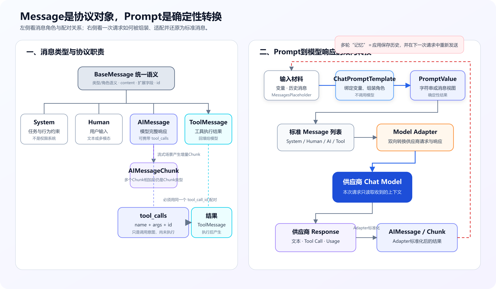

## 模型无状态

Chat Model通常不保存应用中的Python会话对象。模型理解多轮对话，是因为应用在下一次请求中恢复并重新发送了历史消息。

供应商的Conversation ID或Response ID只是特定服务端上下文机制，不能推导为所有LangChain模型都自动有记忆。

历史Message、工具Schema、RAG文档等内容都由应用重新组织并发送给模型，它们共同占用上下文窗口。具体的裁剪、摘要和长期记忆策略统一放在第九章补充说明。

**原理：** 模型“记得”不是参数被修改，而是应用恢复、选择并重新发送了上下文。

## PromptTemplate的数据转换边界

PromptTemplate是确定性数据转换器，只负责变量绑定和消息组装，生成PromptValue，本身不会调用模型。

PromptValue可以转换为字符串交给传统LLM，也可以转换为消息列表交给Chat Model。ChatPromptTemplate会保留System、Human、AI和Tool等角色边界。

`partial()`相当于部分参数绑定，生成携带预填充值的新模板，不是记忆，也不会修改模型。

MessagesPlaceholder在指定位置插入完整Message序列，能够保留Role、Tool Call、ToolMessage和多模态结构，但不负责读取存储、裁剪Token或生成摘要。

**总结：** Prompt负责“怎样组织输入”，Memory负责“信息怎样保存和召回”，Context Engineering负责“本次模型究竟看什么”。

**面试重点：** 能够讲清Message到供应商协议再到AIMessage的双向转换、模型无状态的真实含义、`content`与`content_blocks`的边界，以及PromptTemplate只是确定性转换而不是记忆系统。

# 第五章补充：Tool Calling协议、MCP与安全边界

客户端Tool让模型提出行动请求，但真实行动仍由受控的宿主程序执行。

**本质：** 模型负责语义选择和参数生成，代码负责校验、授权、执行与副作用控制。

## Tool Schema与bind_tools声明机制

一个完整工具包含：

- `name`和`description`，帮助模型识别能力与适用条件。
- `args_schema`，定义参数名称、类型、必填项和约束。
- execution logic，执行Python、数据库或远程调用。
- result/error policy，定义返回形式和异常策略。

`@tool`可以根据函数签名、类型注解和Docstring构造BaseTool。类型注解决定参数形状，描述影响模型何时选择工具。

工具Description不是安全策略，即使写着“仅管理员可用”，服务端仍然必须重新鉴权。

`bind_tools`具有严格的声明流程：

1. 把工具转换成统一Schema。
2. 再转换为供应商支持的工具格式。
3. 将定义绑定到后续模型请求。

它不会执行函数、访问数据库、回传工具结果或自动形成循环。模型返回的`tool_calls`只是结构化调用意图，不能等同于工具已经运行。

**简短勘误：** `invalid_tool_calls`表示工具调用无法被正确解析，通常发生在执行之前；它不是工具函数执行失败的记录。

Schema可以提高格式可靠性，但不能保证模型选对工具，也不能保证参数在业务语义上正确。

## 完整工具调用闭环与错误分层

以下严格顺序描述的是客户端工具（client-side tools），即工具由Agent宿主执行：

1. 模型返回带`tool_calls`的AIMessage。
2. 宿主按名称查找工具。
3. 运行时注入ToolRuntime等隐藏信息，再由BaseTool完成Schema校验。
4. 执行真实函数、协程或远程调用。
5. 结果被包装为ToolMessage或Command。
6. `tool_call_id`把结果关联到原始请求。
7. AIMessage和ToolMessage再次交给模型。
8. 模型继续调用工具或生成最终回答。

上述闭环可以用下面的时序图概括。错误分支表示宿主可以按策略要求模型修正，不代表所有运行时都会自动重试：

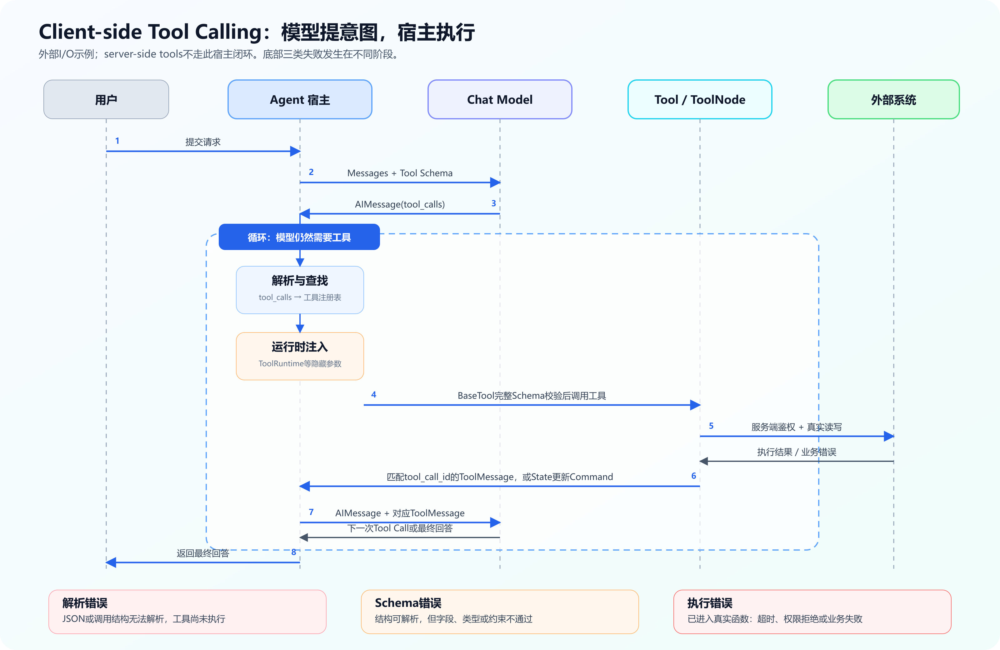

供应商Server-side Tools由Provider在服务端执行，通常不会经过本地ToolRuntime、宿主函数和标准ToolMessage闭环，应按具体供应商协议观察其调用与结果。

客户端工具场景中，一次AIMessage包含多个Tool Call时，每个调用都需要自己的ToolMessage。裁剪历史时也必须保留完整调用与结果配对。

在当前实测`langgraph-prebuilt==1.0.13`中，ToolRuntime可以注入模型不应该填写的信息：

- 当前State与Runtime Context。
- Store与RunnableConfig。
- Stream Writer与`tool_call_id`。
- Thread、Run和重试相关执行信息。

工具错误需要区分：

- 解析错误：调用结构或参数JSON无法解析，工具尚未执行。
- Schema错误：参数能够解析，但缺字段、类型不符或违反约束。
- 执行错误：参数通过校验，但函数发生超时、权限错误或业务拒绝。

参数问题适合反馈模型修正，临时网络错误可以有界重试，权限错误应立即拒绝，程序Bug应进入监控。

互相独立的只读Tool Call可以并行；存在结果依赖、共享写入或顺序语义时，应显式串行化或使用确定性工作流。

工具结果中的content发送给模型，artifact保留给应用；Command还可以更新State或参与图控制流。

## MCP、幂等性与安全边界

Tool Calling回答“模型如何表达想做什么”，MCP回答“宿主如何统一连接外部能力”。MCP可以暴露Tools、Resources、Prompts和其他上下文能力。

典型关系是：模型生成Tool Call → 宿主中的MCP Client调用MCP Server → Server访问真实系统 → 结果转换为ToolMessage → 模型继续决策。

模型通常不直接连接MCP Server。MCP工具经过Adapter后，可以表现成普通LangChain Tool，继续使用同一套工具闭环。

Agent重试、网络超时、进程恢复和Checkpoint重放都可能重复执行工具。写操作需要：

- 稳定的业务Idempotency Key。
- 数据库唯一约束、条件更新或事务。
- 将准备与提交拆分。
- 高风险操作前进行人工审批。

`tool_call_id`适合关联模型调用与ToolMessage，但不一定是跨重试都稳定的业务幂等键。

Checkpoint只能保存图状态，不能回滚已经发生的外部副作用。生产环境还必须具备服务端授权、参数白名单、超时限额、租户隔离和审计日志。

**总结：** Tool Schema约束模型怎样表达行动，宿主决定行动是否允许发生；MCP统一连接协议，但不会替代授权、幂等与审计。

**面试重点：** 能够从`bind_tools`只声明不执行讲到完整Tool Call闭环，准确区分`invalid_tool_calls`、Schema校验错误和执行错误，并说明ToolRuntime注入、MCP分层、幂等性与服务端授权为什么缺一不可。

# 第六章补充：结构化输出机制、策略与事实边界

结构化输出用Schema定义模型输出与下游程序之间的数据契约。

**本质：** Schema解决可解析性、字段类型和显式约束，不直接保证内容真实。

## 四种结构化输出机制

常见实现机制包括：

- Provider-native：供应商原生接收Schema并约束生成，通常可靠性最高。
- Tool Calling：把Schema转换成提交结果的工具，通过Tool Call参数传递数据。
- JSON Mode：通常保证合法JSON，但不一定完整满足指定Schema。
- Prompt加Output Parser：在Prompt中描述格式，再由应用解析文本。

Provider-native约束最强，但只有部分模型支持，不同供应商支持的JSON Schema子集也不同，复杂Schema仍可能被拒绝。

Tool Calling借用工具参数通道传递结果，要求模型支持工具调用。格式错误时，运行时可以把校验信息反馈给模型重新生成。

JSON Mode只解决JSON语法，字段语义、必填项和枚举约束仍需Prompt说明和应用校验。

Prompt加Parser兼容范围最广，但容易受到多余说明、Markdown围栏和字段漂移影响，适合作为缺少原生能力时的兼容方案。

**取舍原则：** 优先使用模型稳定支持的Provider-native；其次使用Tool Calling；JSON Mode和Prompt Parser需要更强的应用端验证。

`create_agent(response_format=...)`的自动策略只在ProviderStrategy与ToolStrategy间选择；JSON Mode和Prompt加Parser属于应用显式实现的兼容方案：

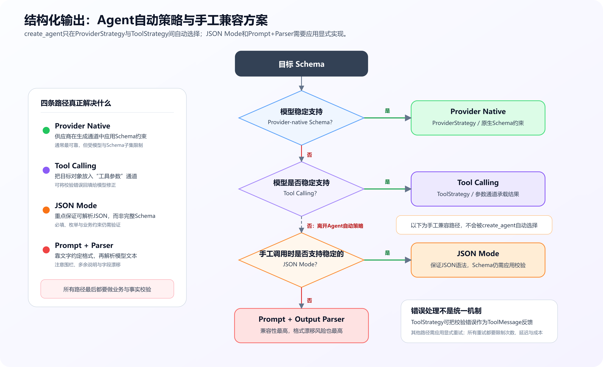

## LangChain策略与执行流程

`with_structured_output`通常返回新的Runnable包装器，不会永久修改原模型。

直接模型结构化输出具有严格顺序：

1. 读取目标Schema。
2. 转换为供应商原生Schema或Tool Schema。
3. 调用模型生成结果。
4. 提取JSON或Tool Call参数。
5. 反序列化为Python对象或字典。
6. 按Schema类型和解析路径执行校验。

`include_raw=True`通常同时保留原始AIMessage、解析结果和解析异常，便于读取Token、Metadata和定位问题。

Agent级结构化输出包含三类策略：

- ProviderStrategy使用供应商原生能力。
- ToolStrategy把Schema转换成结构化输出工具。
- 直接传入受支持的Schema类型时，Agent可根据模型能力自动选择。

显式指定策略可以固定行为，但不能让不支持该能力的模型凭空获得支持。最终结果写入Agent State的`structured_response`。

ToolStrategy发生可修复错误时，可以形成反馈闭环：

1. 模型产生错误结构。
2. Parser或Schema校验失败。
3. 错误原因被包装为ToolMessage。
4. 模型读取错误后重新生成。

自动重试会增加调用次数、延迟和成本，必须设置停止条件。其他策略不一定具有同样的ToolMessage重试路径。

## Schema类型与事实正确性边界

常见Schema类型包括：

- Pydantic：提供字段描述和运行时类型与约束校验，通常返回Pydantic实例。
- TypedDict：通常返回字典；直接模型包装器一般不提供Pydantic式自动校验，而当前Agent结构化输出路径会通过TypeAdapter校验，具体以执行路径为准。
- dataclass：适合轻量数据描述，验证能力取决于具体解析路径。
- JSON Schema：适合跨语言契约；原始Schema字典在部分ToolStrategy路径中主要用于描述参数形状，不保证自动运行完整JSON Schema Validator，应用仍应显式校验。

Schema类型决定返回对象、运行时校验能力和跨语言兼容性，不只是代码写法不同。

复杂Schema会增加输入Token，也更容易在深层嵌套、Union和大量Optional字段上失败。复杂抽取更适合拆成多个阶段，并对关键字段增加确定性校验。

结构化输出可以约束或检查：

- 输出可解析。
- 字段类型满足声明。
- 必填项和显式约束成立。

实际保证强度取决于Provider、实现方式、Schema类型以及是否执行运行时Validator。

它不能单独保证：

- 事实来自可信来源。
- 引用真正支持陈述。
- 业务决策合理。
- 模型不存在幻觉。

生产系统还需要业务规则校验、可信RAG或Tool证据、引用追踪和持续评估。

**总结：** Schema是语法和类型契约；事实可靠性来自数据源、业务校验、引用与评估。

**面试重点：** 能够比较Provider-native、Tool Calling、JSON Mode和Prompt Parser的约束强度，说明ProviderStrategy与ToolStrategy的选择逻辑，准确区分Pydantic运行时校验与TypedDict等静态描述，并明确“结构合法不等于事实正确”。

# 第七章补充：Agent运行循环原理

Agent不是“拥有意识的对象”，而是让模型参与下一步决策、让运行时负责执行动作的一套循环控制系统。

**本质：** 模型负责选择，框架负责调度，工具负责产生真实结果，State负责承接过程。

## Agent的定义与适用边界

Chain、Workflow与Agent的差异主要在控制权：

- Chain的步骤和顺序基本固定。
- Workflow可以分支、并行和循环，但路由规则主要由代码确定。
- Agent把部分下一步选择交给模型，例如是否调用工具、调用哪个工具、何时结束。

Agent适合意图开放、工具选择依赖语义、步骤难以提前枚举的任务。

高风险、强顺序或强确定性流程，不适合完全交给Agent：

- 支付、退款、删除数据等真实副作用。
- 必须严格按业务规则执行的审批。
- 输入、输出和分支都可以提前穷举的流程。
- 对调用次数、成本和延迟有硬上限的链路。

**常见工程形态是“确定性Workflow包围Agent”**：代码负责鉴权、规则校验和最终执行，Agent只负责理解、规划或候选选择。

## create_agent的循环与State

LangChain 1.x的`create_agent()`返回`CompiledStateGraph`。创建阶段并不调用模型，而是构造一张可以反复执行的状态图。

图通常包含Model Node；传入工具时包含Tools Node；Node-style Middleware被编译为节点，Wrap-style Middleware被包在模型或工具调用外层。

默认`AgentState`至少包含`messages`，启用结构化输出时还可以包含`structured_response`，也可以扩展任务阶段、审批结果和业务对象。

**State不是Prompt。** 只有Model Node从State中选择并组装进消息、系统提示词、工具Schema或响应Schema的内容，模型才能看到。

State字段通过Reducer合并更新。`messages`通常使用`add_messages`：新ID追加、相同ID替换，并支持显式删除；它不是简单覆盖整个列表。

一次默认循环有严格顺序：

1. Model Node读取当前State并组装模型请求。
2. 模型返回`AIMessage`，其中可能是最终文本，也可能包含`tool_calls`。
3. `AIMessage`经Reducer合并进State。
4. 路由检查是否存在工具调用。
5. 没有工具调用时进入结束路径。
6. 存在工具调用时，Tools Node根据名称找到工具并校验参数。
7. 工具结果以带对应`tool_call_id`的`ToolMessage`，或以更新状态和路由的`Command`返回。
8. 新结果合并进State，模型读取观察结果后再次决策。

**ReAct勘误：** ReAct在工程上应理解为“决策—行动—观察”的控制循环，不等于框架会暴露模型完整的私有思维链。可稳定观测的是工具请求、工具结果、允许公开的推理摘要和最终回答。

Agent的循环、结束和暂停恢复关系如下：

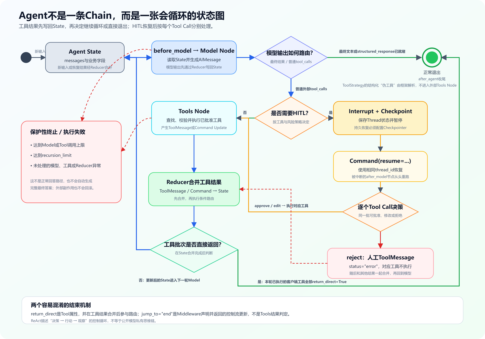

## 并发、结束与控制边界

一次`AIMessage`可以包含多个工具调用。互相独立的调用通常会在同一个super-step并行执行，每个结果通过自己的`tool_call_id`与请求配对。

同一super-step内的节点读取本轮开始时的State，局部更新在步骤边界统一合并。多个分支写同一字段时必须有合适的Reducer，不能依赖“谁先完成”。

有数据依赖的工具必须显式串行；有外部副作用的工具还需要事务、幂等键或服务端去重，因为State Reducer不能替外部系统回滚。

正常退出路径包括：

- 模型不再返回工具调用。
- 结构化结果通过校验。
- 工具配置为直接返回。
- Middleware跳转到结束路径。

以下情况属于保护性终止或执行失败，不是正常回答路径：

- 调用上限策略主动终止。
- 出现未处理异常。
- 达到图的`recursion_limit`。

`recursion_limit`限制的是图的super-step数量，不等于“最多调用N次工具”；触发时会抛出递归上限错误，也不会自动生成完整的最终回答。

未知工具和参数校验错误可以转成错误`ToolMessage`让模型修正；任意工具内部异常并不保证默认被吞掉，生产环境应明确配置重试、错误转换和告警。

Agent反复调用工具通常源于工具描述含糊、返回结果不可操作、完成条件不清，或者State没有记录已经尝试的动作。

保护措施包括调用上限、重复调用检测、清晰的成功和失败条件、可操作的错误信息，以及把高风险执行放回确定性代码或人工审批。

Interrupt用于在图的明确边界暂停，常见于人工审批和等待外部事件。恢复时，包含`interrupt()`的Node会从函数开头重新执行，因此Interrupt之前的副作用可能再次发生；这类操作必须使用幂等键、事务或服务端去重。Checkpointer只能恢复图状态，不能回滚已经发生的外部副作用。

配置Checkpointer后，Durable Execution的可靠性取决于Checkpoint边界和持久性等级：`sync`在下一Step前同步落盘，恢复窗口最小但延迟更高；`async`与下一Step并行持久化，吞吐更好但存在较小崩溃窗口；`exit`只在图退出时持久化，不适合要求中途恢复的长任务。Task或独立节点可以形成恢复边界，但仍可能重执行；外部副作用仍需幂等键、事务或服务端去重。

多智能体并不是另一套运行时，而是控制权与上下文的组织方式：

- **Subagents**：主Agent保留控制权，把子任务作为Tool委派给工作Agent。
- **Handoffs**：把后续控制权和必要State交给另一个Agent，适合职责明确的阶段切换。
- **Router**：代码或模型先分类，再选择专用Agent或Workflow，路由后通常不形成自由循环。
- **Skills**：按需加载指令与资源，重点是减少常驻上下文，而不是启动新的Agent。
- 无论哪种模式，都要限制每个Agent可见的Messages、Tools、Memory和权限，避免把完整上下文无差别复制给所有Agent。

**面试重点：** 能讲清`create_agent`是状态图、Model与Tools如何循环、State与Reducer怎样承接并发更新、Agent有哪些真实结束条件，并说明Durable Execution、多智能体控制权与ReAct的边界。

# 第八章补充：Middleware运行原理

Middleware用于在不修改Agent核心循环的前提下，拦截、修改或增强执行过程。

**本质：Callback主要负责观察，Middleware可以真正参与数据流和控制流。**

## Middleware与Callback的边界

Callback通常用于日志、Trace、Token统计和生命周期事件监听，重点是记录“发生了什么”。

Middleware可以改变：

- 发给模型的Messages和System Prompt。
- 当前使用的Model、Tools和Response Format。
- State中的计数器、上下文和业务字段。
- 是否继续调用模型或工具。
- 异常如何重试、转换或向外抛出。
- 是否暂停、跳转或提前结束。

创建Agent时，Middleware会成为Agent结构的一部分，而不是在图外临时扫描的一组函数。

适合放入Middleware的是跨多个Agent复用的横切逻辑，例如限额、缓存、脱敏、审计和容错。

只属于某个业务步骤的核心规则，应放在明确的Node、Tool或Workflow中，避免把关键流程隐藏在Hook顺序里。

## Node-style与Wrap-style机制

Node-style Hook会成为图中的节点，负责在生命周期边界读取State并产生局部更新。

四个主要时机是：

- `before_agent`：每次Agent调用开始时执行一次，同一个Thread再次调用时仍会再次执行。
- `before_model`：每一轮模型调用前执行，Agent循环时会重复进入。
- `after_model`：每次模型返回后执行，可检查消息、更新State或改变路由。
- `after_agent`：Agent正常进入最终退出路径前执行一次，适合收尾和统计。

Node-style Hook返回的State Update仍然经过Reducer；通过`jump_to`改变路由时，还必须预先声明允许跳转的目标。

Wrap-style Hook直接包围一次真实调用：`wrap_model_call`包围模型，`wrap_tool_call`包围工具。

Wrapper拿到`handler`后可以：

- 调用一次，完成正常执行。
- 不调用，直接返回缓存、拒绝结果或短路响应。
- 调用多次，实现Retry或Fallback。
- 修改Request后再调用，实现动态模型、Prompt或工具选择。

多个Middleware按列表顺序组成洋葱结构。对于`A、B、C`，before Hook通常是`A → B → C`，after Hook是`C → B → A`，Wrapper则是`A(B(C(handler)))`。

Node-style与Wrap-style进入Agent执行过程的位置不同，其基础顺序可以概括为：

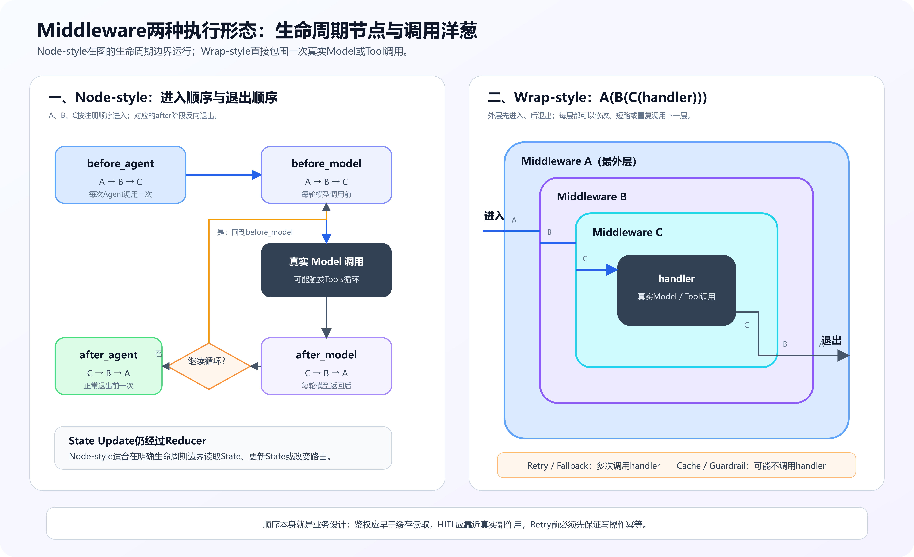

图中的Wrap-style路径表示A、B、C各调用一次Handler的基础情况；短路、重复调用和修改Request等变化仍由上下文及后面的模式列表说明。

**更新原则：** 修改本次Model Request时优先使用`wrap_model_call`；持久更新State时，Node-style可以直接返回字典，支持Command或ExtendedModelResponse的Wrap-style路径也可以产生State Update，最终都要遵守State Schema和Reducer。

## 常见模式、顺序与取舍

常见Middleware虽然都属于横切能力，但底层机制和风险不同：

- **Retry**：捕获可恢复异常后再次调用Handler，适合限流、超时等瞬时故障；工具存在副作用时必须先保证幂等。
- **Fallback**：主模型或主服务失败后切换备用实现；备用项必须兼容工具调用、结构化输出、上下文长度和安全要求。
- **Cache**：根据规范化Request生成Key，命中时跳过真实调用；Key应包含模型、Prompt、工具Schema、版本和权限作用域。
- **Call Limit**：分别统计Model Call和Tool Call，达到阈值后终止、跳转或抛错；它不等同于图的`recursion_limit`。
- **Summarization**：达到Token或消息阈值后，用摘要替换较早历史并保留近期消息；摘要是有损压缩。
- **HITL**：在高风险工具产生真实副作用前触发Interrupt，等待人工批准、修改或拒绝，再通过同一Thread恢复执行。
- **Guardrail**：在输入、模型输出或工具调用前后执行确定性规则、分类器或额外模型检查；Prompt约束不能替代服务端权限校验。

Middleware顺序本身就是业务设计：先鉴权还是先读缓存、一次Retry是否消耗Call Limit、Fallback是否复用原缓存Key，都会改变安全、成本和可观测结果。

鉴权应先于缓存读取，缓存Key必须包含权限作用域；HITL应靠近真正产生副作用的工具，而不是只审批模型生成的一段自然语言。

**总结：Middleware应该让Agent主流程更清晰，而不是把主流程变成一组依赖偶然顺序的隐式行为。**

**面试重点：** 能区分Middleware与Callback，说明Node-style和Wrap-style如何进入Agent图、多个中间件的洋葱顺序，以及Retry、Cache、HITL等模式为什么必须同时考虑幂等、权限和调用边界。

# 第九章补充：上下文与记忆原理

大模型本身通常是无状态的。所谓“记住”，本质上是应用保存信息，并在后续模型调用前重新选择和注入。

**本质：** Context Engineering解决“这一次模型应该看到什么”，Memory解决“信息怎样跨时间保存和召回”。

## 五类上下文的边界

LangChain应用中容易混淆的五类数据是：

- **Model Context**：当前一次模型真正看到的System Prompt、Messages、Tools、Response Format和RAG文档。
- **State**：当前Thread中会变化的任务状态，例如消息、任务阶段、工具结果和审批状态。
- **Runtime Context**：本次执行期间通常不变的依赖，例如`user_id`、`tenant_id`、权限信息和数据库连接。
- **Store**：跨Thread保存的应用数据，例如用户偏好、长期事实、经验和共享知识。
- **RunnableConfig**：执行控制信息，例如Callbacks、Tags、并发配置、`thread_id`和`recursion_limit`。

几个边界不能混淆：

- State不等于Model Context，字段只有被选入Model Request后模型才能看到。
- 身份和权限属于Runtime Context，不应混进模型可以修改的State。
- `thread_id`定位执行时间线，不等于`user_id`或租户身份。

**边界原则：** 业务状态、执行依赖、持久数据和模型可见内容必须分开建模。

五类上下文与两种持久化机制的边界如下，重点看哪些信息能够直接进入模型：

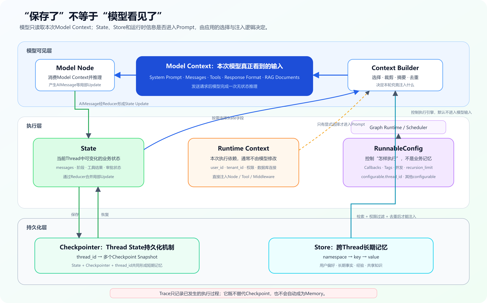

## 短期记忆与Checkpointer

短期记忆可以概括为`State + Checkpointer + thread_id`。

形成过程有严格顺序：

1. Agent接收新消息并更新State。
2. Model、Tool和Middleware继续产生局部更新。
3. Checkpointer在图的super-step边界保存State Snapshot。
4. 下一次调用传入相同`thread_id`。
5. LangGraph默认读取该Thread的最新Checkpoint。
6. 新输入经Reducer与历史State合并，模型再次读取所需上下文。

Checkpoint相关标识的作用不同：

- Checkpoint不只是聊天记录，还可以保存State各Channel的值、下一步任务、配置、Metadata和Interrupt。
- `thread_id`标识一条执行时间线。
- `checkpoint_id`标识时间线上的具体快照。
- 从历史Checkpoint重新执行更接近创建执行分支，不是让现实世界回滚。

长对话需要在信息完整性与Token预算之间取舍：

- Trim描述裁剪策略，不决定是否持久化：只修改Model Request时原State不变；返回RemoveMessage等State Update时，裁剪结果会写入State。
- Delete从State真正删除历史，状态更小但信息不可从当前State恢复。
- Summarize把旧历史压缩为摘要并持久更新State，节省Token但会丢失细节。

裁剪或摘要时必须保持`AIMessage(tool_calls)`与对应`ToolMessage`的协议完整，不能只保留其中一侧。

## 长期记忆与Store

Store按`namespace → key → value`组织长期数据，作用域可以跨Thread，也可以由应用定义为用户级、租户级或全局级。

把信息写入Store只完成了“保存”。完整链路是：按当前任务检索、执行权限过滤和去重、转换成消息或Prompt，再注入本次Model Context。

长期记忆常按内容分为：

- **Semantic Memory**：用户偏好、稳定事实和概念。
- **Episodic Memory**：过去发生的任务、行动和结果。
- **Procedural Memory**：完成任务的方法、规则、Prompt或Skill。

Store支持长期记忆，但不会自动把全部数据放进Prompt；检索过多同样会制造噪声、增加Token并暴露不应访问的信息。

Namespace只是逻辑分组，不是权限系统。应用必须验证调用者身份，不能直接使用模型生成的`tenant_id`或`user_id`访问数据。

多个Thread更新同一份记忆时，需要版本号、事务、唯一键、Upsert或冲突合并策略。

Memory与RAG可以共用Embedding和Vector Store，但目标不同：Memory强调交互产生的可更新状态，RAG强调外部知识库中的回答证据。

**面试重点：** 能清楚区分Model Context、State、Runtime Context、Store和RunnableConfig，说明短期记忆为何依赖Checkpointer与Thread，并解释长期记忆为什么必须经过检索和注入才会影响模型。

# 第十章补充：RAG系统原理

RAG不是“把文档放进向量数据库”，而是在生成前为当前问题找到、筛选并组织可验证的外部证据。

**本质：** RAG是一套数据治理、检索、排序、上下文构造、生成和评估系统，而不是一个Vector Store组件。

## 两条相对独立的链路

典型RAG通过外部检索增强上下文，本身不要求修改模型参数，也可以与微调结合。它的目标之一是降低幻觉风险，但错误或过期的检索结果同样可能放大错误。

典型离线索引主路径如下，具体系统可以合并、跳过或并行部分处理：

1. 从文件、网页、数据库或API加载数据。
2. 解析正文、标题、表格、页码和其他结构。
3. 清洗噪声并统一格式。
4. 切分为适合检索的Chunk。
5. 生成Embedding或其他检索表示。
6. 建立索引并保存原文、Metadata、稳定ID和版本信息。

典型在线主路径如下，其中Query改写、多路融合、Rerank和后验校验按需求启用：

1. 理解用户问题，必要时结合会话改写Query。
2. 服务端鉴权并生成允许访问范围的Metadata Filter。
3. 从一个或多个Retriever召回候选，并尽量在检索阶段应用权限Filter。
4. 对候选执行业务过滤、去重和多路融合。
5. 按需使用Reranker重新排序候选。
6. 按Token预算组装上下文，让模型生成、引用、校验或在证据不足时拒答。

几个边界需要同时保留：

- `Document`的核心是正文、Metadata和可选ID；生产索引最好使用稳定的Document ID与Chunk ID。
- 索引链和在线链要分别调试，错误可能来自解析、切分、索引、召回、排序、上下文组装或生成。
- RAG与Agent是正交关系：固定的两步RAG可以没有Agent，Retriever也可以作为Tool交给Agent按需调用。

两条链路及其连接关系如下，其中Query改写和Rerank都是按需启用的步骤：

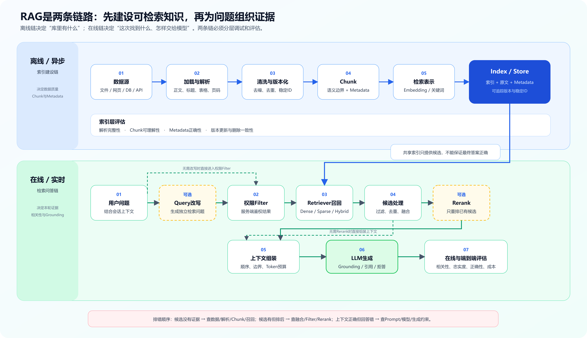

## Chunk与Embedding的取舍

Chunk决定系统以什么粒度匹配知识，但检索单位、返回单位和最终上下文单位不一定相同。

Chunk参数的主要权衡是：

- Chunk更小通常提高定位粒度，但不保证检索更准确；语义不足时，Embedding和排序效果也可能下降。
- Chunk太大，上下文更完整，但无关内容会稀释表示，并快速占满Token预算。
- Overlap太小会丢失边界语义，太大会增加索引成本、重复召回和上下文噪声。
- Parent-Child模式可以让小Chunk负责召回、大Parent负责提供完整上下文。

切分策略需要按文档结构和语言定制Separator，同时确认`chunk_size`的长度单位究竟是字符还是Token。

Embedding把文本映射到固定维度的向量空间。相近只表示模型学习到的表示更接近，不表示事实正确。文档和查询应分别使用`embed_documents()`与`embed_query()`；部分模型会为两类输入使用不同指令或编码方式。

Embedding分数必须结合具体后端解释：

- Cosine Similarity和Dot Product通常越大越相似。
- Euclidean Distance等距离值通常越小越相似。
- 分数不是概率，不同模型、距离函数和数据库的分数不能直接比较。
- 阈值必须在自己的数据集上校准。

更换Embedding模型或版本时，如果向量空间、维度或分数语义不兼容，必须重新Embedding并重建索引；解析、清洗、Chunk、正文或Metadata结构变化，也可能独立要求重建索引。

## Retriever、搜索与Rerank

两者职责不同：

- Vector Store负责保存向量并执行相似度搜索。
- Retriever提供“Query输入、Document列表输出”的上层接口，底层可以连接Vector Store、BM25、Web搜索、SQL、图数据库或多个检索器。

所以Vector Store不等于Retriever，更不等于完整RAG。

常见召回方式各有边界：

- **Dense Retrieval**擅长同义表达和语义相关性，但可能漏掉编号、错误码、函数名和罕见专有词。
- **Sparse Retrieval**擅长精确词面匹配，但对同义改写和语义表达不敏感。
- **Hybrid Search**同时使用Dense与Sparse结果，再通过排名融合或经过校准的分数进行合并。

检索阶段还要处理以下取舍：

- **精确检索与ANN**：精确最近邻返回指定距离函数下的精确Top-K，但不代表语义或事实正确；ANN以潜在召回损失换取更低延迟。
- **Metadata Filter**：承载服务端鉴权结果生成的检索范围，但Filter本身不是鉴权系统，不能直接信任模型生成的租户或权限条件。
- **Top-K与Threshold**：Top-K过小容易漏证据，过大会增加噪声；阈值方向取决于后端返回的是相关性还是距离。
- **Rerank**：先扩大候选集合以优先提高召回率，再过滤、去重和重排；Reranker只能重排已有候选，不能找回第一阶段完全遗漏的文档。

## 生成、引用与分层评估

生成阶段需要同时处理：

- **上下文组装**：控制文档数量、顺序、去重、边界和总Token预算。
- **安全边界**：检索文档属于不可信输入，不能凭文档指令获得更高权限。
- **Grounding**：回答中的陈述应有证据支持，证据不足时应拒答或请求补充。
- **引用**：依赖稳定ID、页码和来源，不能让模型自行编造URL。

评估必须分层：

- 解析与索引层检查正文完整性、结构、Metadata、版本更新和Chunk可理解性。
- Retrieval层检查候选相关性，以及有标注集时的Hit Rate、Recall@K和Precision@K；排序专项可扩展MRR或nDCG。
- Generation层检查Answer Relevance、Groundedness和Citation Correctness；存在参考答案或权威事实基准时，再评估Correctness。
- 端到端层检查答案质量、失败率、延迟、Token、检索次数和重排成本。

排查错误时按现象定位：

1. 候选集中没有证据，检查数据、解析、Chunk和召回。
2. 候选存在但排名靠后，检查融合、Filter和Reranker。
3. 上下文正确但回答错误，再检查Prompt、模型和生成约束。

结构化聚合、精确计算和事务查询通常更适合SQL或确定性API，不能只召回几个Chunk后让模型估算。

**面试重点：** 能把RAG拆成索引与在线问答两条链路，解释Chunk和Embedding分数的取舍，区分Vector Store、Retriever、ANN、Hybrid Search与Reranker，并能沿解析、召回、排序、生成四层定位质量问题。
