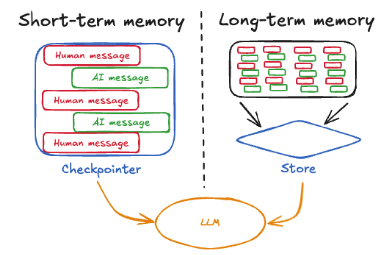
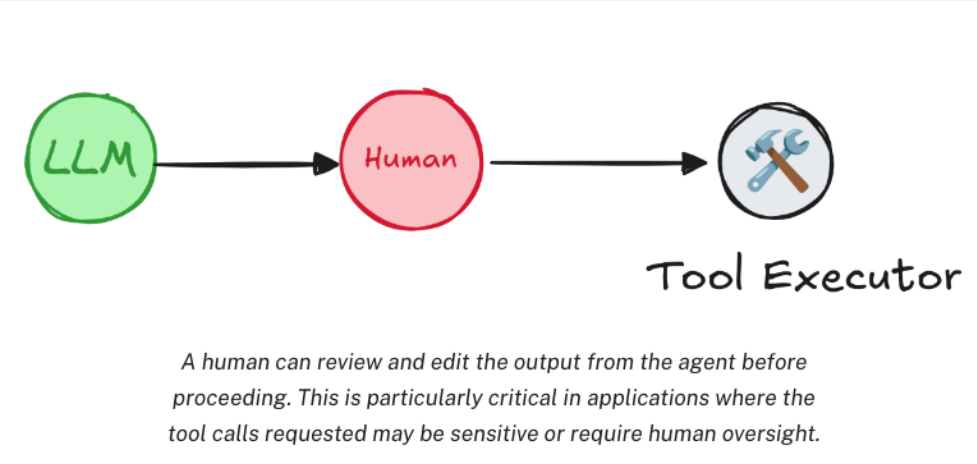
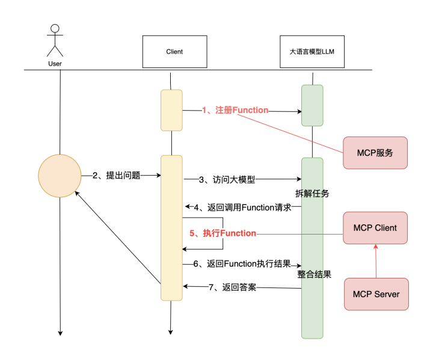
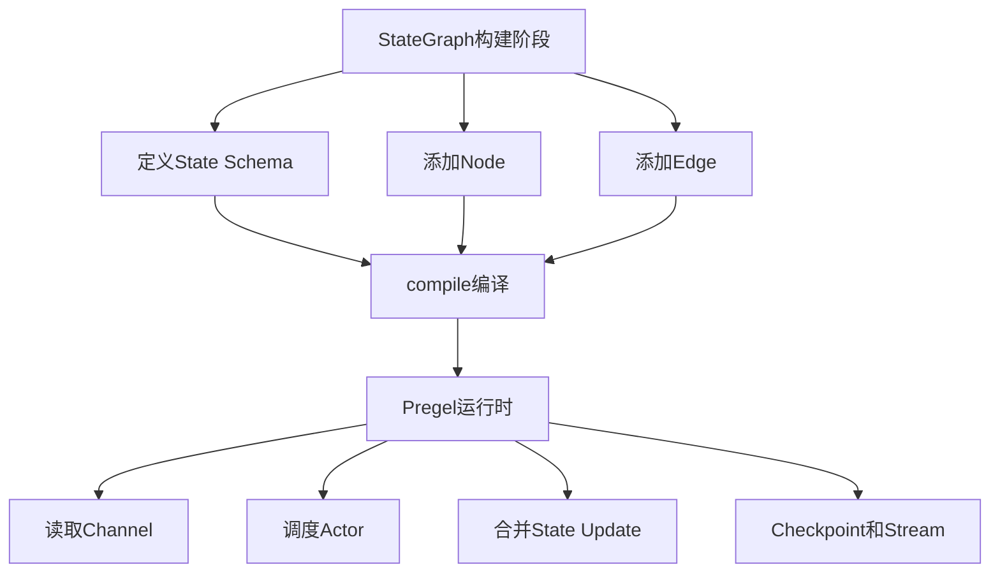
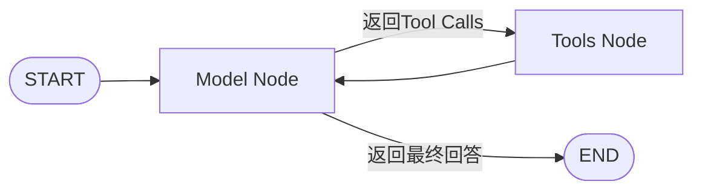
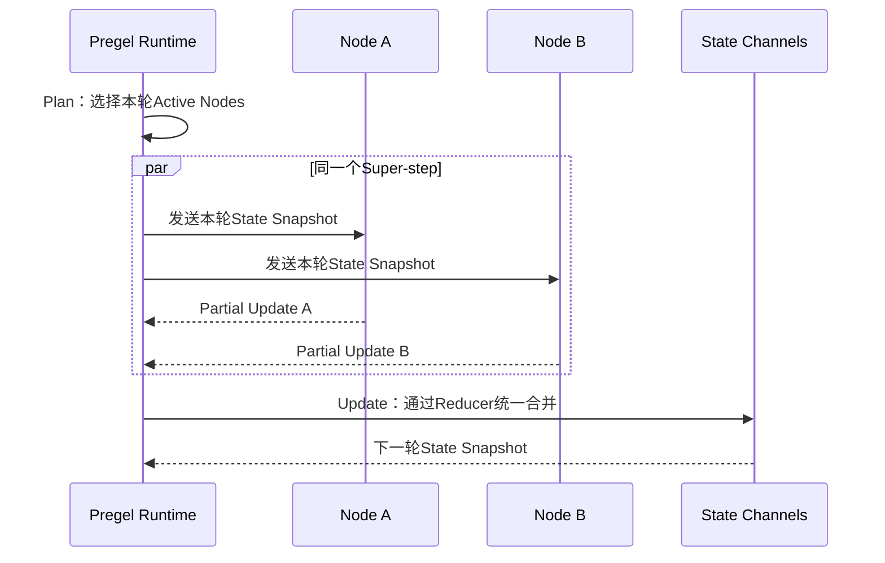

# 1、简述

LangGraph最重要的是Graph。

LangGraph是一个用于大语言模型LLM提供支持的本地应用构建**框架**，是LangChain框架的一个生态组件。

**LangGraph构建应用的标准流程：**

- Prebuilt agents：第一步，构建Agent 智能体
- LangGraph framework：第二步，构建LangGraph应用，主要以Graph图的方式将多个Agent智能体整合成一个整体【核心】
- LangGraph platform：第三步：通过LangGraph Platform平台部署应用，商业化部署，提供测试、监控、分析等能力（非重点））


### LangChain和LangGraph的区别：

**LangChain：高层开发框架**，让你快速连接大模型、工具、向量数据库、RAG 和 Agent。

**LangGraph：底层编排框架/运行时**，让你精确控制复杂 Agent 的执行流程、状态、分支和循环。


- LangChain 和 LangGraph 都用于构建大模型应用，但抽象层级不同。
- LangChain 是高层应用框架，提供模型、Prompt、Tool、Retriever、RAG 和 Agent 等标准组件，适合快速开发常见的 LLM 应用。
- LangGraph 是更底层的有状态工作流编排框架，通过 State、Node 和 Edge 显式定义执行流程，适合复杂分支、循环、持久化、故障恢复和人工审批等场景。
- 两者不是竞争关系。现在 LangChain 的 Agent 底层就是基于 LangGraph 实现的。简单 Agent 我会优先使用 LangChain；如果需要精确控制执行路径、维护长期状态或实现复杂多 Agent 协作，我会使用 LangGraph，实际项目中也经常组合使用。


**为什么不全部使用 LangGraph？**

> LangGraph 抽象层级更低，需要自己定义状态和流程。普通 RAG 或工具调用 Agent 使用 LangChain 开发更快，只有流程复杂时才需要下沉到 LangGraph。

**LangGraph 为什么适合复杂 Agent？**

> 因为它把执行过程表示为有状态图，节点负责执行，边负责流程跳转，可以自然表达分支、循环、并行、重试、暂停和恢复。


# 2、构建智能体

**什么是Agent？**

**没有标准答案，可以类比为一个好员工，这个员工既能力强大，可以放心的独立完成任务，而不用过多干预实现的细节。同时，这个员工又能够听从安排，关键节点及时跟领导请求，并及时根据领导的指示调整自己的工作进度。**


### 创建

langchain已经进行了封装，只需要简单的封装就可以完成与大模型的交互

```python
agent = create_agent(
	model=llm,
	tools=[],
	prompt="You are a helpful assistant",
)

for chunk in agent.stream(
     {"messages":[{"role":"user","content":"你是谁？能帮我解决什么问题？"}]},
    # stream_mode="messages"
):
    print(chunk)
    print("\n")
```

流式输出的格式：

- updates : 流式输出每个⼯具调⽤的每个步骤。 
- messages: 流式输出⼤语⾔模型回复的Token。 
- values: ⼀次拿到所有的chunk。默认值。 
- custom : ⾃定义输出。主要是可以在⼯具内部使⽤get_stream_writer获取输⼊流，添加⾃定义的内容。 


### 工具调用

工具调用的几个步骤

1. 客户端定义工具类
2. 客户端请求大语言模型，带上问题以及工具的描述信息
3. 大模型LLM综合判断问题，并决定是否调用工具
4. 如果大语言模型判断需要调用工具，就会向客户端返回一个带有tools_call工具调用信息的AiMessage
5. 客户端根据工具调用信息，调用工具，并把结果返回给大语言模型
6. 大语言模型根据工具调用的结果，生成最终的答案


**工具的使用**

方式一：定义函数，创建agent传入函数

```python
def get_current_date():
"""获取今天⽇期"""
return datetime.datetime.today().strftime("%Y-%m-%d")


agent = create_react_agent(
	model=llm,
	tools=[get_current_date],
	prompt="You are a helpful assistant",
)
```

方式二：注解方式，创建agent时自动传入

```python
from langchain_core.tools import tool
from langgraph.prebuilt import ToolNode, create_react_agent


# 定义工具：return_direct=True 表示直接返回工具结果
@tool("divide_tool", return_direct=True)
def divide(a: int, b: int) -> float:
    """计算两个整数的除法。

    Args:
        a: 被除数
        b: 除数

    Returns:
        两数相除的结果
    """
    if b == 1:
        raise ValueError("除数不能为 1")

    return a / b


print(divide.name)
print(divide.description)
print(divide.args)


# 定义工具调用错误处理函数
def handle_tool_error(error: Exception) -> str:
    """处理工具调用错误。

    Args:
        error: 工具调用异常
    """
    if isinstance(error, ValueError):
        return "除数为 1 没有意义，请重新输入除数和被除数。"

    if isinstance(error, ZeroDivisionError):
        return "除数不能为 0，请重新输入除数和被除数。"

    return f"工具调用错误：{error}"


# 创建工具节点
tool_node = ToolNode(
    [divide],
    handle_tool_errors=handle_tool_error,
)


# 创建 ReAct Agent
agent_with_error_handler = create_react_agent(
    model=llm,
    tools=tool_node,
)


# 调用 Agent
result = agent_with_error_handler.invoke(
    {
        "messages": [
            {
                "role": "user",
                "content": "10 除以 5 等于多少？",
            }
        ]
    }
)


# 打印结果
print(result)
# print(result["messages"][-1].content)
```

### 消息记忆

记忆分为长期记忆和短期记忆

- 短期记忆：Agent内部的记忆，用于当前对话中的历史记忆信息，LangGraph将它封装为checkPoint
- 长期记忆：Agent外部的记忆，用第三方存储长久的保持用户级别或者应用级别的聊天信息，LangGrapgh将它封装为Store



####  短期记忆 CheckPoint

创建Agent时，只需要指定checkpointer属性就可以实现短期记忆，LangGraph默认提供了InMemorySaver用于将短期记忆保存在内存中，也可以存在Redis、SQLite等三方存储中。checkpointer时，需要thread_id来区分不同的对话，**一般默认短期记忆在内存中，资源少。**


短期记忆可以定期进行清理，防止历史消息过多，LangGraph提供了pre_model_hook属性的hook，

两种管理方式：

- Summarization总结：⽤⼤模型的⽅式，对短期记忆进⾏总结，然后再把总结的结果作为新的短期记忆。 
- Trimming 删除：直接把短期记忆中最旧的消息删除掉。

#### 长期记忆

短期记忆通过thread_id来区分不同的对话，⽽⻓期记忆则通过namespace来区分不 同的命名空间。


### Human-in-the-loop⼈类监督

创建Agent添加Tools工具，需不需要调用工具，完全交给Agent决定，这可能会出现错误的判断。Human-in-the-loop的出现，在Agent进行工具调用的过程中，允许用户进行监督，需要中断当前的执行任务，等待用户输入后，再恢复任务。




```python
from langgraph.checkpoint.memory import InMemorySaver
from langgraph.types import interrupt
from langgraph.prebuilt import create_react_agent
from langchain_core.tools import tool


# An example of a sensitive tool that requires human review / approval
@tool(return_direct=True)
def book_hotel(hotel_name: str):
    """预定宾馆"""
    response = interrupt(
        f"正准备执行'book_hotel'工具预定宾馆，相关参数名：{{'hotel_name': {hotel_name}}}. "
        "请选择OK，表示同意，或者选择edit，提出补充意见."
    )
    if response["type"] == "OK":
        pass
    elif response["type"] == "edit":
        hotel_name = response["args"]["hotel_name"]
    else:
        raise ValueError(f"Unknown response type: {response['type']}")
    return f"成功在 {hotel_name} 预定了一个房间."


checkpointer = InMemorySaver()
agent = create_react_agent(
    model=llm,
    tools=[book_hotel],
    checkpointer=checkpointer,
)

config = {
    "configurable": {
        "thread_id": "1"
    }
}

for chunk in agent.stream(
    {"messages": [{"role": "user", "content": "帮我在图灵宾馆预定一个房间"}]},
    config
):
    print(chunk)
    print("\n")
    
    
for chunk in agent.stream(
    # Command(resume={"type": "OK"}),
    Command(resume={"type": "edit", "args": {"hotel_name": "三号宾馆"}}),
    config
):
    print(chunk)
    print(chunk['tools']['messages'][-1].content)
    print("\n")    
```


```python
{'__interrupt__': (Interrupt(value="正准备执⾏'book_hotel'⼯具预定宾馆，相关参数名：
{'hotel_name': 图灵宾馆}. 请选择OK，表示同意，或者选择edit，提出补充意⻅.", resumable=True, ns=
['tools:3e143aac-9c42-9f34-162c-c0e42c08165b']),)}

{'tools': {'messages': [ToolMessage(content='成功在 三号宾馆 预定了⼀个房间.',
name='book_hotel', id='97532b7c-f383-46ce-813e-c27891214c4a',
tool_call_id='call_c9978e4809f447d286914b')]}}
成功在 三号宾馆 预定了⼀个房间.
```


### LangGraph接入MCP


#### MCP的执行过程：




**MCP协议本身不包含任何具体的工具实现，只是用协议的形式规定了应用程序如何向大模型提供函数调用的能力。**

至于为什么mcp接入简单，是因为客户端Client封装了调用能力，统一了交互方式。


#### MCP两个实现方式

**SSE**

```json
{
    "mcpServers": {
        "amap-amap-sse": {
        	"url": "https://mcp.amap.com/sse?key=你在⾼德官⽹上申请的key"
         }
     }
}
```


**STDIO**

```json
"amap-maps": {
    "command": "npx",
    "args": [
        "-y",
        "@amap/amap-maps-mcp-server"
    ],
    "env": {
        "AMAP_MAPS_API_KEY": "451ad40d0e39453600f2a305e31eabe4"  # 替换为你的高德地图API Key
    },
    "transport": "stdio"
}
```


- SSE：其实是⼀种基于HTTP协议实现的⻓连接协议，只不过SSE协议是⼀种从服务端向客户端单向推送数据的 ⻓连接协议。也就是⾼德地图需要提供⼀个HTTP服务，然后客户端可以和这个HTTP服务建⽴⼀个⻓连接，这 样客户端就可以不断的访问⾼德地图的HTTP服务，获得⾼德地图的服务数据。这时候的⼯作机制其实和以往 我们熟悉的基于HTTP的⼯作机制本质上是很像的。只是服务端的性能压⼒会⼤⼀点⽽已。 

- STDIO： 这种⼯作机制的本质是在客户端本地执⾏⼀个应⽤程序，然后通过应⽤程序获得对应的结果。这时 候MCP的核⼼问题就出来了。MCP的服务是由MCP的服务提供者设计的，但是执⾏却是在客户端的机器执 ⾏。


#### LangGraph接入

```python
from langchain_community.chat_models import ChatTongyi
from mcp import MultiServerMCPClient  # 假设这是正确的导入路径
from langgraph.prebuilt import create_react_agent


# 构建阿里云百炼大模型客户端
llm = ChatTongyi(
    model="qwen-plus",
    api_key=load_key("BAILIAN_API_KEY"),  # 需要确保 load_key 函数已定义
)

# 相比Cline客户端配置，只要增加transport属性即可。
# 不过测试streamable_http有问题，不知道是不是版本的原因。
client = MultiServerMCPClient(
    {
        "amap-amap-sse": {
            "url": "https://mcp.amap.com/sse?key=451ad40d0e39453600f2a305e31eabe4",
            "transport": "streamable_http"
        }
    }
)

tools = await client.get_tools()

agent = create_react_agent(
    model=llm,
    tools=tools
)
```


# 3、Graph

Graph是LangGraph的核心，以有向无环图的方式串联多个Agent。有向无环图用来描述任务之间的依赖关系。

主要包含三个基本元素：

- state：在整个应用中共享的数据结构
- Node：一个处理数据的节点，LangGraph中通常是一个Python函数，以state作为输入，处理后返回更新的state
- Edge：表示Node之前的依赖关系，LangGraph中通常也是一个python函数，根据state来决定接来下走哪个node


```python
from typing import TypedDict
from langgraph.constants import END, START
from langgraph.graph import StateGraph
class InputState(TypedDict):
user_input: str
class OutputState(TypedDict):
graph_output: str
class OverallState(TypedDict):
foo: str
user_input: str
graph_output: str
class PrivateState(TypedDict):
bar: str
def node_1(state: InputState) -> OverallState:
# Write to OverallState
return {"foo": state["user_input"] + ">学院"}

def node_2(state: OverallState) -> PrivateState:
# Read from OverallState, write to PrivateState
return {"bar": state["foo"] + ">⾮常"}
def node_3(state: PrivateState) -> OutputState:
# Read from PrivateState, write to OutputState
return {"graph_output": state["bar"] + ">靠谱"}
# 构建图
builder = StateGraph(OverallState,input=InputState,output=OutputState)
# 添加Node
builder.add_node("node_1", node_1)
builder.add_node("node_2", node_2)
builder.add_node("node_3", node_3)
# 添加Edge
builder.add_edge(START, "node_1")
builder.add_edge("node_1", "node_2")
builder.add_edge("node_2", "node_3")
builder.add_edge("node_3", END)
# 编译图
graph = builder.compile()
# 调⽤图
graph.invoke({"user_input":"图灵"})
```


查看node图

```python
from IPython.display import Image, display
# draw_mermaid⽅法可以打印出Graph的mermaid代码。
display(Image(graph.get_graph().draw_mermaid_png()))
```


## State

State是所有节点共享的状态，是一个字段，包含了所有节点的状态。节点之间交互的参数字段。

TypedDict字典，也可以是Pydantic中的⼀个BaseModel，都是key、value的字典形式。


State可以更新state中的值

```python
class State(TypedDict):
	messages: Annotated[list[AnyMessage], add_messages]
	list_field: Annotated[list[int],add]
	extra_field: int
```

如果有⼀个node，返回了State中更新的值， 那么messages和list_field的值就会添加到原有的旧集合中， ⽽extra_field的值则会被替换。


## Node

处理数据的节点

- 在langGraph中，Node通常是一个python函数，接受一个state作为对象输入，返回一个state对象作为输出
- 每个Node有一个唯一名称字符串，如果没有提供，默认生成一个和函数名一样的名称
- Node具体实现中，通常包含两个参数：第一个是state，必选参数，第二个是可选的配置项config，包含运行的配置参数
- LangGraph对每个Node提供了缓存机制，只要Node传入的参数相同，LangGraph优先从缓存中获取Node的执行结果，提升Node的运行速度，可以指定缓存过期时间5s

```python
def node_1(state:State , config: RunnableConfig):
    time.sleep(3)
    user_id = config["configurable"]["user_id"]
    return {"number":state["number"] + 1, "user_id":user_id}
builder = StateGraph(State, config_schema=ConfigSchema)
# Node缓存5秒
builder.add_node("node1", node_1,cache_policy=CachePolicy(ttl=5))
```


- Node还支持重试机制，以及重复执行次数限制

  ```python
  builder.add_node("node1", node_1,retry=RetryPolicy(max_attempts=4))
  
  print(graph.invoke(xxxxx, config={"recursion_limit":25}))
  ```

  

## Edge

通过Edge边把Node节点连接起来，决定了state如何在graph如何在Graph中传递

- ### 普通Edge边

LangGraph提供了两个默认的Node START和END，作为Graph的入口和出口，也可以通过set_point指定

```python
builder = StateGraph(State)
builder.set_entry_point("node1")    <==> builder.add_edge(START, "node1")
builder.set_finish_point("node2")   <==> builder.add_edge("node1", END)
```

- ### 条件Edge和EntryPoint

可以添加条件边，用来构建复杂的工作流程，可以用一个函数，返回值是下一个Node的名称

```python
def routing_func (state:State) -> str:
    if state["number"] > 5:
    	return "node1"
    else:
    	return END
builder.add_conditional_edges( START, routing_func)
```

也可以把条件边函数返回值作映射，作为公共决策的函数

```python
def routing_func (state:State) -> bool:
	if state["number"] > 5:
		return True
	else:
		return False
builder.add_conditional_edges( START, routing_func,{True: "node_a", False: "node_b"})
```

- ### Send动态路由

可以Node同时路由到多个Node，可以通过Send，

Send对象可传⼊两个参数，第⼀个是下⼀个Node的名称，第⼆个是Node的输⼊。

```python
def routing_func (state:State):
	result = []
	for message in state["messages"]:
		result.append(Send("node1",{"msg":message}))
	return result
# 通过路由函数，将消息中每个字符串分别传⼊node1处理。
builder.add_conditional_edges( START, routing_func,["node1"])
```

- ### Command命令

Graph中⼀个典型的业务步骤是State进⼊⼀个Node处理。在Node中先更新State状态，然后再通过 Edges传递给下⼀个Node。如果希望将这两个步骤合并为⼀个命令，那么还可以使⽤Command命令。


## 子图

一个graph不仅可以单独使用，还可以作为别的graph的Node使用，这种就是子图。添加方式和子节点一样。调用子图等价于，subgraph.invoke(state)


## LangGraph

结合LLM大模型构建LangGraph


### Human-In-Loop⼈类⼲预

- 必须指定⼀个checkpointer短期记忆，否则⽆法保存任务状态。 
- 在执⾏Graph任务时，必须指定⼀个带有thread_id的配置项，指定线程ID。之后才能通过线程ID，指定恢复 线程。 
- 在任务执⾏过程中，通过interrupt()⽅法，中断任务，等待确认。 但中断时间不能过长，过长后无法恢复任务。
- 在⼈类确认之后，使⽤Graph提交⼀个resume=True的Command指令，恢复任务，并继续进⾏。 也可以是一个字典，通过字典进行更多的判断


### Time Travel时间回溯 

由于大模型回答的不确定性，所以需要对这种不确定性进行更精确的检查和回溯，当某个步骤发现问题时，从发现问题的步骤进行重演。Time Travel 时间回溯能力，可以保存Graph的运行过程，可以手动指定从Graph的某个Node重新演练


- 回溯时，指定thread_id 线程Id，并且要基于线程ID，再执行check point 检查点，在每一个Node执行后，都会生成一个check_point_id
- 指定thread_id和check_point_id，进行任务重演，重演前可以更新state，也可以不更新。


```python
# 获取所有 checkpoint 状态
states = list(graph.get_state_history(config))

# 选择需要恢复的历史状态
selected_state = states[1]

# 更新状态中的 author 字段
updated_config = graph.update_state(
    selected_state.config,
    values={"author": "郭德纲"},
)

# 从更新后的状态继续执行
graph.invoke(
    None,
    config=updated_config,
)
```


---


# 第一章补充：LangGraph的定位与整体原理

LangGraph不是一个“让大模型变聪明”的框架，也不是另一种Prompt框架。

**本质：LangGraph是一个面向长时间运行、有状态、可恢复任务的图执行框架。**

大模型只负责概率性的理解、推理和决策，LangGraph负责在模型外部维护确定性的执行秩序，包括：

- 当前任务执行到了哪一步。
- 每一步可以读取什么数据、更新什么数据。
- 下一步应该进入哪个Node。
- 哪些Node可以并行执行。
- 什么时候循环，什么时候结束。
- 任务中断后怎样恢复。
- 节点失败后怎样重试或从Checkpoint继续。

所以LangGraph解决的不是“如何调用一次LLM”，而是“如何把多次LLM调用、普通代码、工具、人工审批和持久化组合成一个可靠的应用”。


## LangGraph不是有向无环图

原笔记中把Graph描述成“有向无环图”，这个说法不准确。

**LangGraph支持有环图，循环正是它与普通DAG工作流的重要区别。**

Agent的典型执行过程就是一个循环：

```text
模型判断 -> 调用工具 -> 工具返回 -> 模型继续判断 -> …… -> 生成最终答案
```

如果只能使用DAG，这种循环只能预先展开固定次数，就无法表示“模型根据运行结果决定是否继续”。

LangGraph中的`recursion_limit`也不是禁止图出现环，而是防止错误路由、模型失控等原因造成无限循环。


## Graph不是业务流程图片，而是可执行程序

LangGraph中的Graph可以从两个角度理解：

- 从开发角度看，Graph由State、Node和Edge构成。
- 从运行时角度看，Graph由Actor和Channel构成，底层通过Pregel运行时执行。

StateGraph只是开发者使用的高层API。调用`compile()`以后，Graph会被编译成一个可以执行的Pregel应用。



`compile()`主要完成以下工作：

- 检查Graph结构是否合法。
- 把State字段转换为运行时Channel。
- 把Node转换为可以调度的Actor。
- 把Edge转换为节点之间的触发关系。
- 绑定Checkpointer、Store、Cache和中断配置等运行能力。

所以Builder只是“图的定义”，Compiled Graph才是“可以执行的应用”。


## LangChain、LangGraph和LangSmith的边界

- **LangChain**：提供Model、Message、Prompt、Tool、Retriever、Agent和Middleware等高层应用组件。
- **LangGraph**：提供State、Node、Edge、Reducer、Checkpoint、Interrupt和Durable Execution等运行时能力。
- **LangSmith**：记录和评估执行过程，解决Trace、调试、评测和监控问题。

三者不是替代关系。

LangChain的`create_agent`底层会创建一个LangGraph状态图；LangGraph中的Node又可以直接使用LangChain的Model、Tool和Retriever；整个执行过程还可以交给LangSmith观察。

**简单应用优先使用LangChain的高层封装；只有需要显式状态、复杂路由、循环、恢复和人工干预时，才需要直接设计LangGraph。**


## Workflow和Agent的区别

Workflow和Agent都可以用LangGraph表达，但控制权不同。

- **Workflow工作流**：执行路径主要由开发者提前定义，确定性强，容易测试和审计。
- **Agent智能体**：下一步动作主要由模型根据当前上下文动态决定，灵活性强，但成本、延迟和不确定性更高。
- **混合模式**：外层使用确定性Workflow控制阶段，局部节点内部允许Agent自主决策。

实际项目中，混合模式通常比“所有步骤都交给Agent”更加可靠。

例如订单退款可以把身份验证、权限检查、金额校验和真正退款设计为确定性Node，只把“理解用户诉求”和“整理回复”交给大模型。

**原则：能用确定性代码表达的业务规则，不要交给概率性模型决定。**


**面试重点：** 能说明LangGraph不是DAG框架，而是支持循环、状态和持久化的图执行运行时；能够区分LangChain、LangGraph和LangSmith，并解释Workflow与Agent的控制权差异。


# 第二章补充：Agent与ReAct循环原理

Agent不是一个单独的大模型，也不是一个固定的类。

**本质：Agent是“模型决策 + 工具执行 + 状态更新 + 循环控制”共同组成的运行系统。**

大模型本身只完成一次输入到输出的计算。它不会自己真正调用天气接口、数据库或者文件系统，也不会自动保存前一次执行状态。

应用需要在模型外部完成以下工作：

1. 把用户消息、System Prompt和工具Schema发送给模型。
2. 解析模型返回的普通回答或者Tool Call。
3. 根据Tool Call找到真实工具并执行。
4. 把工具结果封装为ToolMessage写回Messages。
5. 再次调用模型。
6. 直到模型不再请求工具，或者进入其他结束路径。


## create_agent底层是什么

`create_agent`返回的不是一个神秘的Agent对象，而是一个已经编译好的LangGraph Graph。

最核心的结构可以简化为：



- Model Node读取Messages并调用大模型。
- Tools Node执行一个或多个工具调用。
- 条件路由检查最新AIMessage中是否包含`tool_calls`。
- 有Tool Call就进入Tools Node，没有就结束。

Middleware、结构化输出、人工审批、模型Fallback等能力，都是在这个基础状态图上增加Node、Wrapper、State字段或者路由规则。


## ReAct不是固定格式，而是一种控制循环

ReAct可以理解为Reasoning和Acting交替进行：

```text
观察当前上下文 -> 判断下一步动作 -> 执行动作 -> 观察动作结果 -> 继续判断
```

在现代Tool Calling模型中，模型的内部推理过程不一定作为文本暴露出来，但外部控制循环仍然存在。

因此不要把ReAct简单理解成必须打印`Thought / Action / Observation`三段文字。真正重要的是：

- 模型能够根据当前State选择动作。
- 工具结果会重新进入模型上下文。
- 模型可以根据新结果继续、纠错或者结束。


## Agent的结束条件

Agent不能只依靠“模型自己会停下来”。常见结束条件包括：

- 模型返回普通AIMessage，不再包含Tool Call。
- 得到符合Schema的结构化结果。
- 某个工具设置为直接返回结果。
- 业务State达到明确的完成状态。
- 人工拒绝继续执行。
- 调用次数、Token、费用或者时间达到业务上限。

`recursion_limit`只是运行时最后的安全阀。达到限制时通常表示Graph没有正常收敛，会抛出错误，并不等于Agent已经生成了完整答案。

**一个可靠Agent必须有业务结束条件、失败结束条件和资源上限，不能只有END节点。**


## Agent为什么会反复调用同一个工具

常见原因不是LangGraph循环错误，而是模型没有获得清晰的完成信号：

- Tool描述没有说明何时使用、何时不要使用。
- Tool返回内容不能让模型判断任务是否成功。
- State没有记录已经尝试过的动作。
- 错误信息只说“失败”，没有提供可修正信息。
- System Prompt没有定义完成条件。
- 同一个动作产生副作用后，模型仍然无法从Messages确认结果。

解决方式包括明确Tool Contract、记录尝试次数、检测重复Tool Call、增加业务状态机，以及把高风险循环放回确定性Workflow。


**面试重点：** 能把Agent解释为一个状态循环，说明Model Node和Tools Node如何通过Messages协作，理解ReAct是控制模式而不是固定输出格式，并能列出Agent真正的结束条件。


# 第三章补充：Tool Calling与MCP原理

Tool Calling经常被误解为“大模型调用了函数”。

**本质：模型只生成结构化的调用意图，真正的函数查找、权限校验和执行全部发生在应用侧。**


## Tool Calling是一套消息协议

一次完整调用由三部分组成：

1. 应用把工具名称、描述和参数Schema提供给模型。
2. 模型返回带有`tool_calls`的AIMessage，每个调用都有名称、参数和`tool_call_id`。
3. 应用执行工具，再返回具有相同`tool_call_id`的ToolMessage。

`tool_call_id`用于把请求与结果配对。模型一次可能返回多个Tool Call，因此不能只按照消息顺序猜测哪个结果属于哪个调用。

Tool Schema只是告诉模型“可以怎样申请调用”，不是安全边界。

即使参数通过了Schema校验，服务端仍然需要进行：

- 用户身份验证。
- 资源权限校验。
- 参数范围和业务规则校验。
- 限流、审计和敏感数据过滤。
- 高风险操作的幂等和人工审批。


## ToolNode解决了什么

ToolNode是LangGraph中预构建的工具执行Node，主要负责：

- 从AIMessage中解析多个Tool Call。
- 根据名称找到对应的Tool。
- 注入State、Runtime Context和Store等运行信息。
- 并行执行相互独立的工具。
- 把结果转换为符合协议的ToolMessage。
- 根据配置处理工具错误和Command。

ToolNode解决的是“执行协议适配”，不负责判断业务操作是否安全。

如果多个工具存在先后依赖，例如“先创建订单，再根据订单ID付款”，就不能因为模型一次返回了两个Tool Call而盲目并行执行，应该显式拆成不同步骤。

如果工具会修改外部世界，例如扣款、发邮件、删除文件，必须使用幂等键、事务或者服务端去重。State Reducer只能合并Graph内部状态，不能回滚外部副作用。


## MCP不是工具本身

MCP规定Client怎样发现和调用Server提供的能力，但它不实现具体业务。

MCP中主要有三类能力：

- **Tools**：可执行动作，模型可以申请调用。
- **Resources**：可读取的上下文资源，例如文件、数据库结果或文档。
- **Prompts**：Server提供的可复用Prompt模板。

LangChain的MCP Adapter会把MCP Tool转换成LangChain Tool，然后才能交给LangChain Agent或者LangGraph ToolNode使用。

所以完整关系是：

```text
MCP Server -> MCP Client / Adapter -> LangChain Tool -> LangGraph ToolNode -> Agent循环
```


## MCP Transport只是通信方式

- **stdio**：Client启动本地子进程，通过标准输入输出通信，适合本地工具和开发环境。
- **Streamable HTTP**：Client通过HTTP访问远程MCP Server，适合远程服务和多客户端场景。
- **SSE**：旧版远程Transport，目前应优先使用Streamable HTTP，除非对接的Server只支持旧协议。

Transport决定“消息怎样传输”，不决定Tool语义、权限和Agent流程。

`MultiServerMCPClient`默认通常按一次调用创建并清理Session；如果Server需要跨多次调用维护会话状态，需要显式管理持久Session。不能因为stdio子进程一直存在，就默认每个Tool Call一定共享同一个MCP会话。


## MCP接入后的安全边界

MCP Server是独立进程或者远程服务，不能默认信任。

生产环境至少需要考虑：

- Server来源和版本是否可信。
- 远程HTTP连接如何认证和加密。
- Tool权限是否按用户和租户隔离。
- Tool描述和返回内容是否可能包含Prompt Injection。
- 本地stdio进程可以访问哪些文件和环境变量。
- API Key不能直接写进Markdown和代码仓库。

MCP统一了连接协议，但没有自动解决鉴权、沙箱、Prompt Injection和数据泄露问题。


**面试重点：** 能说明大模型只生成Tool Call而不执行函数，理解AIMessage与ToolMessage通过`tool_call_id`配对，区分MCP的Tools、Resources、Prompts和Transport，并能解释Tool Schema为什么不是权限系统。


# 第四章补充：Pregel与Super-step运行原理

StateGraph只是表层API，LangGraph真正的执行核心是Pregel运行时。

**本质：Pregel使用Bulk Synchronous Parallel模型，把Graph拆成一轮一轮的Super-step执行。**


## 一个Super-step的三个阶段

每一个Super-step包含三个阶段：

1. **Plan计划阶段**：根据上一轮哪些Channel发生了更新，决定本轮要激活哪些Node。
2. **Execution执行阶段**：本轮所有被激活的Node并行执行，产生局部State Update。
3. **Update更新阶段**：所有Node完成后，运行时通过Reducer把局部Update合并到Channel，形成下一轮可见的新State。




## 同一轮并行Node看不到彼此的更新

这是理解LangGraph并发最重要的一点。

同一Super-step中的Node读取的是本轮开始时的同一个State Snapshot。Node A即使先执行完成，它产生的Update也不会立即对Node B可见。

只有所有并行Node结束并进入Update阶段后，合并结果才会在下一个Super-step中可见。

这相当于在每一轮之间设置了一个同步屏障，可以避免并行Node因为执行速度不同而读取到不一致的中间状态。

因此：

- 不要依赖并行Node的实际完成顺序。
- 有数据依赖的步骤必须放到不同Super-step。
- 多个并行Node写同一个State字段时必须定义合适的Reducer。
- Reducer冲突属于State设计问题，不是线程锁问题。


## Node如何被激活和结束

运行开始时，START把输入写入对应Channel，并激活入口Node。

Node执行后通过Edge向后继Node发送消息。后继Node接收到新消息后，在下一轮变为Active。

当没有任何Node需要继续执行，也没有消息正在传递时，Graph自然结束；显式路由到END则表示该分支不再继续。

如果Graph存在循环，只要State和路由最终满足退出条件，循环仍然可以正常收敛。


## recursion_limit限制的是什么

`recursion_limit`限制的是Graph可以继续执行的Step数量，不等于Python函数递归深度，也不严格等于Tool调用次数。

一次Model Node、一次Tools Node和其他Middleware Node都可能消耗不同的Graph Step。

所以不能用“允许调用10次工具”直接推导`recursion_limit=10`。如果业务确实需要限制工具次数，应该在State中单独记录Tool Call计数。

`RemainingSteps`可以把剩余执行步数作为运行时管理值提供给Graph，使Graph在即将达到上限时进入降级或者总结路径，而不是等到抛出`GraphRecursionError`。


**面试重点：** 能完整解释Pregel的Plan、Execution、Update三阶段，说明并行Node为什么看不到同一轮其他Node的更新，以及`recursion_limit`为什么不等于工具调用次数。


# 第五章补充：State、Channel与Reducer原理

State不是在Node之间不断传递的普通Python字典副本。

**本质：State是Graph在某个时刻的逻辑快照，每个State字段在底层对应一个Channel，Node返回的是对Channel的局部更新。**


## State Schema解决什么

State Schema同时定义了：

- Graph允许保存哪些业务字段。
- Node可以读取哪些字段。
- Node返回的字段应该怎样合并。
- Graph接收什么输入、向外暴露什么输出。

常用形式包括：

- `TypedDict`：轻量，只提供类型提示，不会在运行时自动校验所有数据。
- `dataclass`：可以提供默认值，结构仍然较轻。
- `Pydantic BaseModel`：提供更强的运行时校验，但性能开销更高。

State不是越大越好。把数据库连接、模型客户端、API Key等运行依赖放入State，会造成序列化困难、Checkpoint膨胀和敏感信息泄露。


## State、Runtime Context、RunnableConfig和Store

四者作用不同：

- **State**：当前Thread中会变化、可能需要Checkpoint的业务状态。
- **Runtime Context**：本次运行期间通常不变的依赖，例如`user_id`、权限信息、数据库连接和模型选择。
- **RunnableConfig**：执行控制信息，例如`thread_id`、Tags、Callbacks和`recursion_limit`。
- **Store**：跨Thread保存的长期数据，例如用户偏好和共享知识。

**业务状态、运行依赖、执行配置和长期数据必须分开建模。**

身份与权限信息不能只依赖模型可以修改的State；服务端应从可信Runtime Context中读取并再次校验。


## Node应该返回Partial Update

Node通常只返回自己负责更新的字段，不需要返回整个State。

例如Node只更新`summary`，就只返回：

```python
return {"summary": new_summary}
```

这样做有几个好处：

- 节点职责更清楚。
- 不会无意覆盖其他字段。
- 并行更新可以由Reducer集中处理。
- Trace中可以清楚看到每个Node真正产生了什么变化。

应优先返回新值，而不是原地修改传入的State对象。原地修改会让Update边界变得模糊，也会增加并发和调试风险。


## Reducer决定State怎样演化

每个State字段都有独立的Reducer。

Reducer接收两个参数：

```text
新值 = reducer(当前已经累积的值, Node本次返回的Update)
```

- 没有显式Reducer时，默认使用覆盖语义，右侧Update替换旧值。
- 使用`operator.add`时，列表、字符串或者数值会执行对应的加法语义。
- 使用自定义Reducer时，由业务定义合并、去重、覆盖或删除规则。

Reducer不只是一个方便的列表拼接函数，它实际定义了State字段的“写入语义”。


## 为什么并行写入必须认真设计Reducer

假设Node A和Node B在同一Super-step中都更新`results`：

```text
Node A -> {results: [A结果]}
Node B -> {results: [B结果]}
```

如果`results`使用默认覆盖Reducer，运行时无法把两个值安全地保存成一个LastValue，通常会产生并发更新冲突。

如果`results`使用列表追加Reducer，两个Update才能合并。

自定义Reducer最好满足以下性质：

- **结合性**：不同分组方式不会改变最终结果。
- **交换性**：不依赖并行Node谁先完成时，交换Update顺序结果仍然相同。
- **明确的重复语义**：重试或者恢复时出现相同Update，应该去重还是允许重复必须提前定义。

如果业务结果必须严格有序，不要依赖并行完成顺序，应在Update中携带稳定序号，最后按序号整理。


## add_messages不等于普通列表相加

Messages字段通常使用`add_messages`，它不仅会追加消息，还会根据Message ID处理更新：

- 新ID的Message会追加。
- 相同ID的Message可以替换旧消息。
- 特定RemoveMessage可以删除消息。
- 字典形式的消息会被反序列化为标准Message对象。

普通`operator.add`只会拼接列表，无法正确完成消息替换和删除。

工具调用消息还必须保持协议完整：包含Tool Call的AIMessage与对应ToolMessage不能只保留一侧，否则下一次模型调用可能因为消息序列非法而失败。


## Input、Output和Private State

Graph可以定义不同的输入Schema、输出Schema和内部State Schema。

- Input Schema限制调用者可以输入什么。
- Output Schema限制Graph最终向外暴露什么。
- 内部State保存Node协作所需但不应对外暴露的字段。

Private State不是安全数据库，它只是Graph内部的数据边界。敏感字段仍然需要考虑Checkpoint、Trace和日志是否会记录。


**面试重点：** 能说明State字段在底层对应Channel，Node返回的是Partial Update，Reducer定义每个字段的合并语义；能够区分State、Runtime Context、RunnableConfig和Store，并解释并行写入为什么不能使用默认覆盖语义。


# 第六章补充：Node、Edge、Send与Command原理

Node和Edge不是两个完全对等的业务组件。

- Node负责做事并产生State Update。
- Edge负责根据图结构或者State决定下一步激活谁。

**本质：Node处理数据，Edge传递控制权。**


## Node的边界应该怎样划分

Node粒度过大会产生以下问题：

- 一个Node包含多个外部调用，失败后可能全部重做。
- 无法在中间步骤Checkpoint和Interrupt。
- Trace只能看到一个巨大黑盒。
- 不同错误无法设置不同Retry策略。

Node粒度过小也会增加Graph复杂度、Checkpoint数量和调度开销。

通常适合单独成为Node的边界包括：

- 一次具有独立语义的LLM调用。
- 一次需要单独重试的外部服务调用。
- 一个明确的业务状态转换。
- 一个需要人工审批或者持久化的边界。
- 一个需要独立观察、计费或超时控制的步骤。


## 普通Edge与条件Edge

普通Edge表达固定控制流：Node A完成后总是进入Node B。

条件Edge表达动态控制流：路由函数读取当前State，再返回下一个Node名称或者END。

路由函数最好只负责判断，不要在里面执行昂贵操作或者修改外部系统。否则这部分行为不容易重试、Checkpoint和观察。

如果一个Node同时存在多个普通出边，这些后继Node通常会在同一个Super-step中并行执行。

如果后续Node必须等待多个上游分支全部完成，应显式设计Join边界和Reducer，不能靠“某个分支应该比较慢”来保证顺序。


## Send解决运行时才知道数量的并行任务

普通Edge的目标在构建Graph时已经确定。Send用于在运行时根据State动态产生多份任务，典型场景是Map-Reduce。

```text
items = [A, B, C]
        ↓ Send
process(A)  process(B)  process(C)
        ↓ Reducer
      汇总results
```

每个Send包含目标Node和该次调用的输入。目标Node可以并行处理不同输入，最后通过State Reducer汇总结果。

Send解决的是“动态Fan-out”，不是启动多个长期独立Thread。所有Send任务仍然属于当前Graph Run和当前Super-step语义。


## Command把State Update和路由放在一起

普通模式是：

```text
Node返回Update -> Reducer合并State -> Edge决定下一步
```

Command允许Node一次返回：

- `update`：怎样更新State。
- `goto`：接下来进入哪个Node。
- `resume`：恢复Interrupt时提供什么值。
- `graph`：在子图中跳转到当前Graph还是Parent Graph。

Command适合“更新状态的同时决定控制权”的场景，例如多Agent Handoff。

需要注意：Command只增加动态路由，不会自动取消该Node已经定义的静态Edge。如果同时定义静态Edge并返回`Command(goto=...)`，两个目标都可能执行。

因此同一个Node的后继路由通常应该在“静态Edge / 条件Edge”和“Command”之间选择一种主要方式。


## START和END是什么

START和END是特殊的控制节点，不是普通业务Node。

- START表示Graph输入从哪里进入。
- END表示某一条执行分支到此结束。

多个分支中的一个到达END，不一定意味着其他并行分支被强制取消。整个Graph是否结束，仍然取决于是否还有Active Node或者待处理消息。


**面试重点：** 能解释Node粒度与Checkpoint、Retry、Trace之间的关系，区分普通Edge、条件Edge、Send和Command，并知道Command不会自动覆盖已经存在的静态Edge。


# 第七章补充：子图与多智能体原理

子图不是简单的`subgraph.invoke(state)`语法糖。

**本质：子图是在父Graph中封装一段独立状态机，用来隔离职责、状态和控制流。**


## 父图和子图怎样交换State

主要有两种方式：

- **共享State字段**：父图和子图使用相同字段名，Compiled Subgraph可以直接作为Node加入父图。
- **不同State Schema**：父图Node负责把父State转换为子图输入，再把子图输出转换回父State。

共享Schema使用简单，但会增加耦合。不同Schema隔离更清楚，适合团队边界和多Agent系统。

子图内部字段不会因为“嵌套”就自动成为父图字段。跨边界共享哪些数据必须明确设计。


## 子图持久化的三种语义

子图是否保留内部状态，取决于编译时的Checkpointer配置：

- **Per-invocation，`checkpointer=None`**：默认模式；每次调用从新的子图状态开始，但本次调用可以继承父图持久化能力，用于Interrupt和故障恢复。
- **Per-thread，`checkpointer=True`**：同一个Thread内多次调用会继续积累子图状态，适合真正需要多轮记忆的子Agent。
- **Stateless，`checkpointer=False`**：把子图当普通函数运行，不保存子图Checkpoint，也不能在子图内部实现可靠的Interrupt和Durable Execution。

不是所有子Agent都应该拥有长期对话状态。一次性研究、查询、总结等任务通常使用Per-invocation更加安全，避免不同委派任务之间相互污染。


## 多智能体不是“多个模型一起聊天”

多智能体的核心是控制权和上下文怎样分配。

常见模式包括：

- **Router**：根据任务类型选择某个专用Agent，路由后通常由该Agent独立完成。
- **Subagents**：主Agent保留控制权，把子任务像Tool一样委派给子Agent。
- **Handoff**：当前Agent把控制权和必要State交给另一个Agent，后续由新Agent继续。
- **Parallel specialists**：多个专用Agent并行处理不同部分，最后由Reducer或者汇总Node合并。

每个Agent都应该只看到完成职责所需的Messages、Tools、Memory和权限。

把完整历史、全部工具和所有长期记忆复制给每个Agent，不仅浪费Token，还会扩大错误权限和Prompt Injection影响范围。


## 多智能体的真正成本

增加Agent不会自动提高答案质量，反而会增加：

- 模型调用次数和Token成本。
- 状态同步与结果合并难度。
- 循环、重复委派和互相推诿风险。
- Trace和错误定位复杂度。
- 工具权限和数据隔离风险。

只有任务确实存在不同专业能力、独立上下文或并行价值时，才值得拆成多个Agent。

**原则：先通过单Graph和明确Node解决问题，再在职责边界清晰时拆分子图或多Agent。**


**面试重点：** 能说明子图是独立状态机，理解共享Schema与State转换两种连接方式；能够解释Per-invocation、Per-thread和Stateless持久化语义，并从控制权与上下文隔离角度理解多智能体。


# 第八章补充：Checkpoint、Thread与Store原理

LangGraph中的“记忆”不是模型参数发生了变化，而是应用保存State，并在以后重新加载。

**本质：Checkpointer保存Thread内的执行时间线，Store保存跨Thread的应用数据。**


## Checkpoint保存的不是只有Messages

编译Graph时传入Checkpointer后，运行时会在Super-step边界保存State Snapshot。

一个StateSnapshot通常包含：

- `values`：当前各State Channel的值。
- `next`：下一步准备执行的Node。
- `config`：定位Thread和Checkpoint的信息。
- `metadata`：当前Step、写入来源等元数据。
- `tasks`：下一步任务、错误和Interrupt等信息。
- 父Checkpoint关系和创建时间等时间线信息。

所以Checkpoint不仅用于聊天记录，也用于恢复控制流。


## thread_id与checkpoint_id

- `thread_id`标识一条长期执行时间线，例如一次会话或者一个业务任务。
- `checkpoint_id`标识这条时间线上的某一个具体快照。
- 同一个`thread_id`再次传入普通输入，表示基于该Thread当前状态开始一次新的Graph调用。
- 指定历史`checkpoint_id`，表示从特定历史位置Replay或者Fork。

`thread_id`不等于`user_id`。

一个用户可以拥有多个Thread，一个Thread也不应该被用来充当权限凭证。身份和租户范围必须通过可信上下文另外校验。


## 短期记忆怎样形成

短期记忆可以概括为：

```text
State + Checkpointer + thread_id
```

完整过程是：

1. 新输入从START进入Graph。
2. Node和Reducer不断更新State。
3. Checkpointer在Step边界保存快照。
4. 下一次调用提供相同`thread_id`。
5. 运行时加载该Thread最新State。
6. 新输入与历史State合并后继续执行。

如果使用`InMemorySaver`，数据只存在当前进程内，进程重启后会丢失。生产环境需要数据库等持久化Checkpointer。


## Store为什么是长期记忆

Store保存的是Graph State之外的应用数据，通常按`namespace + key + value`组织。

它可以跨Thread共享，所以适合保存：

- 用户长期偏好。
- 稳定事实和档案。
- 多次任务积累的经验。
- 多个Agent共享的知识。

但把数据写入Store不代表模型自动记住了。

完整链路仍然是：

```text
保存 -> 检索 -> 权限过滤 -> 选择 -> 转换为Context -> 注入模型
```

Store的Namespace只是逻辑分组，不是安全权限系统。服务端必须校验用户和租户是否有权访问对应Namespace。


## Checkpointer、Store和Cache的区别

- **Checkpointer**：保存“这个Thread执行到了哪里、State是什么”。
- **Store**：保存“应用需要长期记住什么数据”。
- **Cache**：保存“相同Node输入是否可以复用以前的计算结果”。

三者不能互相替代。

Cache命中只是在一定时间内跳过计算，不会建立完整执行时间线；Checkpoint能够恢复流程，但不等于跨用户知识库；Store保存长期数据，但不知道Graph下一步应该执行哪个Node。


**面试重点：** 能说明Checkpoint保存State和控制流快照，区分`thread_id`、`checkpoint_id`和`user_id`，并解释Checkpointer、Store和Cache三者分别解决什么问题。


# 第九章补充：Interrupt与Human-in-the-loop原理

Human-in-the-loop不是在程序中执行普通`input()`，而是把一个长任务安全地暂停并在以后恢复。

**本质：Interrupt通过特殊异常结束当前执行，把等待外部输入变成一种可持久化的Graph状态。**


## interrupt发生时做了什么

当Node调用`interrupt(payload)`时：

1. `interrupt()`抛出运行时可以识别的特殊异常。
2. 当前Graph执行在该位置暂停。
3. Checkpointer保存可恢复的State和Interrupt信息。
4. `payload`返回给调用端，用于展示审批内容。
5. Graph可以等待任意长时间。
6. 调用端使用相同`thread_id`和`Command(resume=value)`恢复。
7. `resume`中的值成为Node内部`interrupt()`的返回值。

原笔记中“中断时间不能过长，过长后无法恢复”并不准确。只要使用持久化Checkpointer、Checkpoint没有被清理、Graph代码仍然兼容，任务可以跨进程、跨机器或者等待很长时间后恢复。


## 恢复时Node会从头重新执行

Interrupt最容易踩坑的地方是：恢复时不是从`interrupt()`下一行继续执行，而是整个Node从函数开头重新执行。

运行时会把已有Resume Value与对应Interrupt匹配，因此代码再次运行到`interrupt()`时才得到恢复值。

所以Interrupt之前的代码可能执行两次：

```text
调用外部接口 -> interrupt等待确认
```

这种顺序非常危险。恢复时外部接口可能再次被调用。

更安全的设计是：

```text
准备操作参数 -> interrupt等待确认 -> 执行有副作用的操作
```

如果副作用必须发生在Interrupt之前，就必须使用幂等键、事务或者服务端去重。


## Interrupt的规则

- 不要用普通`try/except`吞掉Interrupt抛出的特殊异常。
- 同一个Node中多个Interrupt的顺序应该保持稳定。
- Interrupt Payload和Resume Value应使用可序列化的简单数据。
- 审批展示的内容不能替代服务端实际权限校验。
- 恢复时必须使用原来的`thread_id`。
- 人工修改参数后，仍要重新执行Schema和业务规则校验。


## 动态Interrupt与静态Breakpoint

- **动态Interrupt**：在Node代码中按业务条件触发，适合人工审批、补充信息和等待外部事件。
- **静态Breakpoint**：配置在某些Node执行前后暂停，适合调试和检查Graph，不适合作为主要业务审批机制。

业务审批需要携带明确的操作、参数、风险和允许动作，因此通常使用动态Interrupt。


## Human-in-the-loop应该放在哪里

人工审批应该靠近真正产生副作用的Node或Tool，而不是只审批大模型生成的一段自然语言。

例如删除文件时，审批内容至少应包含：

- 要执行的真实Tool名称。
- 已经解析和规范化后的目标路径。
- 影响范围。
- 当前用户和权限范围。
- 允许批准、修改还是拒绝。

审批通过后，执行端仍然要验证这些参数没有在等待期间失效。


**面试重点：** 能解释Interrupt怎样依赖Checkpointer和`thread_id`暂停、恢复任务，知道恢复时Node会从头执行，并能说明为什么Interrupt之前的副作用必须幂等。


# 第十章补充：Time Travel与Durable Execution原理

Time Travel并不是让现实世界回到过去。

**本质：Time Travel是在Checkpoint时间线上选择一个历史State，然后Replay原路径或者Fork一条新路径。**


## Replay与Fork

- **Replay重演**：从历史Checkpoint继续，Checkpoint之前的步骤直接复用，之后的Node重新执行。
- **Fork分支**：先通过`update_state()`创建带有修改值的新Checkpoint，再从这个新状态继续，形成不同执行轨迹。

`update_state()`不会原地修改旧Checkpoint，而是创建新的Checkpoint。更新值仍然会经过对应State字段的Reducer。

如果使用`as_node`，相当于告诉运行时“这次更新视为由哪个Node产生”，从而影响接下来从哪个后继Node继续。


## 为什么Replay结果可能不同

历史Checkpoint保存的是State和执行位置，不是把未来所有结果冻结。

Checkpoint之后重新执行的内容可能包括：

- LLM调用。
- 外部API请求。
- Tool调用。
- Interrupt。
- 依赖当前时间和随机数的普通代码。

这些结果都可能与原来不同。

如果外部操作已经真实发生，例如已经扣款、发邮件或者删除记录，Time Travel不会自动撤销这些操作。要实现业务回滚，需要数据库事务、补偿动作或者Saga模式。


## Durable Execution解决什么

Durable Execution表示任务可以在进程崩溃、服务重启或者人工暂停后，从已经保存的边界继续执行，而不是从头开始。

它依赖三个条件：

- 使用持久化Checkpointer保存执行进度。
- 把关键步骤划分为合适的Node或者Task边界。
- 对可能重执行的外部副作用保证幂等。

Checkpoint保证“状态可以恢复”，幂等保证“重执行不会产生重复伤害”。两者缺一不可。


## 持久化模式的取舍

常见Durability模式包括：

- **sync**：每个Step的Checkpoint完成持久化后才进入下一步，恢复窗口最小，但延迟更高。
- **async**：Checkpoint写入与下一步执行并行，吞吐和延迟更好，但进程突然崩溃时可能存在较小窗口。
- **exit**：只在Graph退出时持久化，开销最小，但不适合要求中途恢复的长任务。

选择哪种模式取决于任务价值、可重算成本、延迟要求和副作用风险，不能一律使用性能最高的模式。


## Node和Task是恢复边界

如果一个Node内部连续执行五个昂贵外部调用，Node在第五个调用失败，恢复时前四个调用可能重新执行。

可以通过两种方式改进：

- 把具有独立恢复价值的操作拆成多个Node。
- 在Node内部把操作包装成可Checkpoint的Task，使恢复时能够跳过已经完成的Task结果。

边界越细，恢复越精确，但调度、Checkpoint和存储开销也越高。


**面试重点：** 能区分Replay与Fork，说明`update_state()`创建的是新Checkpoint，理解Time Travel不能回滚外部世界；能够解释Durable Execution为什么同时依赖Checkpoint边界和幂等副作用。


# 第十一章补充：并发、重试、缓存与故障恢复

LangGraph提供了可靠执行能力，但“配置了Checkpointer”并不等于系统自动具备Exactly-once语义。

**本质：LangGraph尽量保存可恢复状态，但外部副作用的正确性仍然由业务系统保证。**


## 并发执行的错误语义

同一Super-step中的多个Node并行执行。如果其中一个Node失败：

- 当前Super-step不能正常完成State合并。
- 已成功Node产生的Pending Writes可以被Checkpointer保存。
- 恢复时可以复用这些成功写入，避免所有成功Node都重新执行。
- 失败Node是否重试取决于Retry Policy和错误类型。

但如果成功Node已经调用外部系统产生副作用，Checkpoint只能记录结果，不能替外部系统撤销或者去重。


## Retry应该只处理可恢复错误

适合重试的错误通常包括：

- 网络暂时不可用。
- 服务端限流。
- HTTP 5xx。
- 临时超时。

不适合盲目重试的错误包括：

- 参数校验错误。
- 权限不足。
- 业务规则不允许。
- 代码逻辑错误。
- 已经确定不存在的资源。

Retry需要同时考虑：

- 最大尝试次数。
- 指数退避和随机抖动。
- 总超时时间。
- 操作是否幂等。
- 最终失败后的Fallback或者补偿路径。

重试不是错误处理的替代品。达到重试上限后，仍需要明确向上抛出、转错误State、进入补偿Node或者请求人工处理。


## Cache的Key决定正确性

Node Cache根据Node输入生成Key，相同Key可以复用以前的输出。

Cache Key如果只包含用户问题，而没有包含模型版本、System Prompt、Tool Schema、权限范围和数据版本，就可能把不兼容或者越权结果返回给当前请求。

不适合直接Cache的Node包括：

- 依赖当前时间或者实时数据。
- 产生外部副作用。
- 输出与用户权限强相关。
- 使用随机性且业务要求每次重新生成。

Cache优化的是计算，Checkpoint保存的是执行历史，二者不要混淆。


## 超时、重试和错误处理顺序

一个Node的失败处理通常可以理解为：

```text
执行Node -> 超时或异常 -> Retry判断 -> 再次执行 -> 重试耗尽 -> Error Handler / 向外抛出
```

Error Handler适合把最终失败转换成业务State，或者返回Command进入Fallback、补偿和人工处理路径。

Interrupt不属于普通业务异常，它用于暂停Graph，不应该被Retry或者Error Handler当作失败吞掉。


## Exactly-once为什么很难

分布式系统中可能发生这种情况：

1. 外部服务已经成功扣款。
2. 当前进程在保存Checkpoint之前崩溃。
3. Graph恢复后再次执行扣款Node。

仅靠LangGraph无法判断第一次扣款是否成功。

需要外部服务支持：

- 幂等请求ID。
- 唯一约束。
- 事务状态表。
- 查询操作结果。
- 补偿事务。

因此LangGraph通常提供At-least-once风格的可恢复执行边界，业务系统负责把重复执行变成安全行为。


**面试重点：** 能说明并行Super-step失败时Pending Writes的意义，知道Retry只适合瞬时错误，理解Cache Key为什么必须包含版本和权限范围，并能解释Checkpoint不能单独保证Exactly-once副作用。


# 第十二章补充：Streaming与可观测性原理

Streaming不会改变Graph的执行逻辑，只是把执行过程中不同层级的信息逐步暴露给调用者。

**本质：Stream Mode决定观察哪个数据面，不决定Node如何调度。**


## 常见Stream Mode

- **values**：每个Step结束后输出完整State快照，不是只在最后一次返回所有Chunk。
- **updates**：输出每个Node产生的局部State Update，更适合观察谁修改了什么。
- **messages**：输出LLM产生的Token或者Message Chunk以及相关Metadata。
- **custom**：输出应用通过Stream Writer主动发送的自定义进度。
- **debug**：输出尽可能完整的调试信息，包括Node和State等运行细节。

同一次执行可以关注多个Stream Mode。调用端应根据事件类型处理，不能假设所有Chunk结构相同。


## Token流和Graph步骤流是两层事件

Model Node内部的一次LLM调用可以产生很多Token事件，但从Graph角度看，这些Token仍然属于同一个Node执行。

因此：

- `messages`适合实时展示模型输出。
- `updates`适合展示Node完成后的State变化。
- `values`适合展示每个Super-step后的整体状态。

用户看到Token开始输出，不代表Node已经成功完成或者Checkpoint已经持久化。如果Model Node后续失败，本轮State可能仍然不会提交。


## 子图Streaming的Namespace

父图和子图同时Streaming时，需要通过Namespace区分事件来自哪一层Graph。

如果没有启用Subgraph Streaming，父图可能只能看到子图Node最终产生的Update，而看不到子图内部Model的Token和中间步骤。

Namespace解决的是事件来源定位，不等于长期记忆的Namespace。


## Streaming、Logging和Tracing

- **Streaming**：面向当前调用者实时反馈进度。
- **Logging**：记录应用主动输出的日志。
- **Tracing**：记录Run之间的父子关系、输入输出、延迟、Token、错误和Metadata。
- **Checkpoint**：保存可恢复State和执行位置。

Trace可以帮助调试，但不能用于恢复Graph；Checkpoint可以恢复Graph，但不一定包含足够的性能和评测信息。


## 应该观察什么

生产环境至少要能够定位：

- 每个Node的输入摘要、输出摘要和耗时。
- Model调用次数、Token和费用。
- Tool名称、参数摘要、结果和错误。
- Retry次数和最终失败原因。
- 当前Thread、Checkpoint和Interrupt位置。
- Graph循环次数和结束原因。
- Reducer冲突、重复Tool Call和异常长路径。

敏感数据、API Key、完整用户隐私和工具返回原文不应该无差别写入Trace。


**面试重点：** 能准确区分`values`、`updates`、`messages`和`custom`，理解Token事件与Graph Step不是一个层级，并能区分Streaming、Tracing和Checkpoint。


# 第十三章补充：LangGraph应用设计方法

LangGraph最难的部分不是调用API，而是设计State和执行边界。

**本质：先把业务建模为状态机，再把需要模型判断的部分放入Node。**


## 第一步：先定义State，不要先画Node

先回答以下问题：

- 任务从开始到结束需要保存哪些事实？
- 哪些字段是当前Thread状态？
- 哪些字段只是本次运行依赖？
- 哪些信息需要跨Thread保存？
- 哪些字段会被多个Node并行写入？
- 每个字段的覆盖、追加、去重和删除语义是什么？

State设计清楚后，Node和Edge通常会自然出现。


## 第二步：区分确定性步骤和概率性步骤

适合普通代码Node的内容：

- 权限校验。
- 金额计算。
- 格式转换。
- 数据库事务。
- 明确业务规则。

适合LLM Node的内容：

- 理解自然语言意图。
- 非结构化内容总结。
- 从多个合理动作中做启发式选择。
- 生成自然语言结果。

不要让LLM判断本来可以由数据库约束或者代码条件准确判断的事情。


## 第三步：定义每条路径的结束条件

每个循环都应该有：

- 正常成功条件。
- 可重试失败条件。
- 不可重试失败条件。
- 人工处理条件。
- 最大Step、时间、费用或者调用次数。

如果只能说“模型觉得完成就结束”，说明状态机还没有设计完整。


## 第四步：选择Node和Checkpoint边界

对于每个步骤都要问：

- 这个步骤失败后是否值得单独重试？
- 服务重启后是否希望跳过它？
- 是否需要在它之前或者之后人工审批？
- 是否有外部副作用？
- 是否需要单独观察耗时和成本？

答案为“是”的步骤通常应该成为独立Node或Task。


## 第五步：设计并行和Reducer

只有真正相互独立的任务才适合并行。

并行前检查：

- 两个Node是否读取同一份稳定State Snapshot。
- 是否写入相同字段。
- Reducer是否能够无顺序依赖地合并。
- 是否调用同一个有并发限制的外部资源。
- 一个分支失败时，其他分支结果怎样处理。


## 第六步：设计副作用和恢复

对每个会改变外部世界的操作记录：

- 幂等键从哪里生成。
- 操作结果怎样查询。
- Checkpoint在操作前还是操作后。
- 失败后重试还是补偿。
- 是否需要人工批准。

**先设计恢复，再设计正常路径。** 长时间运行的Agent最危险的问题通常发生在重试、暂停和服务重启时，而不是第一次顺利执行时。


## 第七步：设计上下文，而不是把全部State发给模型

State是应用知道的全部信息，Model Context只是本次模型需要看到的信息。

把完整State、全部历史消息、所有Tool和长期记忆都发送给模型，会产生：

- Token成本增加。
- 关键信息被噪声淹没。
- Prompt Injection影响范围扩大。
- 不必要的隐私暴露。
- 模型选择错误Tool的概率增加。

每个Model Node应该只构造自己需要的Messages、Tools和文档。


## 第八步：测试状态转换，而不只是测试最终答案

LangGraph测试可以分为四层：

- **Node测试**：给定State Snapshot，检查Partial Update。
- **Reducer测试**：检查覆盖、追加、并发合并和重复Update。
- **路由测试**：给定State，检查进入正确Node或者END。
- **恢复测试**：模拟异常、Interrupt、Replay和服务重启，检查是否重复产生副作用。

对于LLM Node，应尽量使用固定响应或者Mock验证Graph控制流，再单独评测真实模型质量。


## 常见错误总结

- 把LangGraph理解成只能执行DAG。
- 把State当成模型一定可以看到的Prompt。
- Node返回整个State，误覆盖其他并行字段。
- 多个并行Node写同一字段却没有Reducer。
- 用`recursion_limit`代替业务调用次数限制。
- Interrupt之前执行非幂等副作用。
- 认为Time Travel可以回滚已经发生的外部操作。
- 把`thread_id`当作`user_id`或者权限凭证。
- 把Store中的全部长期记忆直接塞给模型。
- 认为MCP连接成功就已经解决权限和安全问题。
- 认为使用Checkpointer就自动获得Exactly-once执行。
- 为了“更智能”把所有确定性业务规则都交给Agent。


## 最后总结

LangGraph可以用一句话概括：

> LangGraph通过State保存任务事实，通过Node执行计算和副作用，通过Edge传递控制权，通过Reducer合并并发更新，通过Pregel按Super-step调度，通过Checkpointer保存执行时间线，通过Interrupt和Command暂停、恢复与跳转，最终把概率性的大模型能力放进一个可控制、可观察、可恢复的应用运行时中。

学习LangGraph时，真正需要掌握的不是`add_node()`和`add_edge()`的语法，而是以下六个问题：

1. State中应该保存什么，不应该保存什么？
2. 每个State字段的Reducer语义是什么？
3. 当前Node为什么执行，下一步为什么进入那个Node？
4. 并行Node怎样在Super-step边界合并结果？
5. 中断、失败和服务重启后从哪里恢复？
6. 外部副作用怎样保证幂等、补偿和权限安全？

能够回答这六个问题，才算真正理解LangGraph的原理。


**面试重点：** 不要只背State、Node、Edge三个名词。重点讲清Pregel的Super-step、Reducer的并发语义、Checkpoint的执行时间线、Interrupt的重执行规则、Time Travel的边界，以及确定性Workflow和概率性Agent应该怎样组合。


